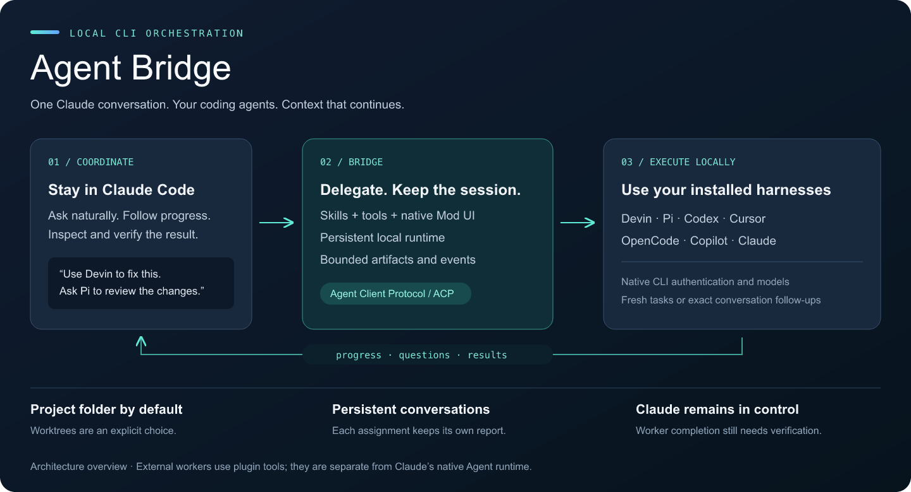
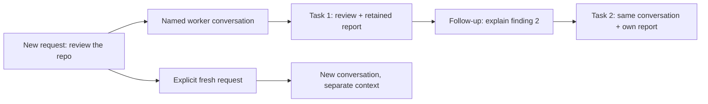
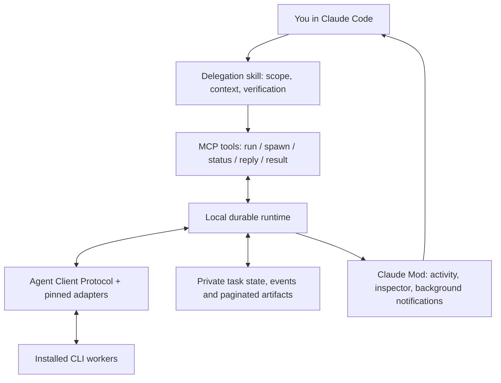

# Agent Bridge

**Use your coding agents from one Claude Code conversation.**



Agent Bridge is a Claude Code plugin for delegating to **Devin, Pi, Codex, Cursor, OpenCode, GitHub Copilot and Claude** as persistent external workers. Ask for work naturally, watch what the worker is doing, continue its conversation, and inspect its results without managing another terminal.

The plugin combines delegation skills, MCP tools and a Claude Mod interface. It starts a small local runtime automatically and reuses your installed CLIs and their existing authentication. It uses **Agent Client Protocol (ACP)** and pinned adapters rather than building another coding-agent framework.

**Current checkpoint: 0.5.2 · Local prototype · 35 runtime tests + 24 Mod-host tests passing.** Live provider results and their limits are recorded in [validation](docs/VALIDATION.md) and the [provider matrix](docs/PROVIDERS.md).

[Quick start](#quick-start) · [Usage](#delegate-in-your-own-words) · [Worker inspector](#watch-and-navigate) · [Architecture](#how-it-works) · [Limitations](#current-boundaries) · [Roadmap](#where-this-goes-next)

## Why use it?

- **Keep Claude as coordinator.** Delegate a bounded job while retaining the main conversation and independent verification.
- **Use the harnesses you already have.** Workers retain native models, tools and account configuration; no Devin Cloud or hosted orchestrator is required.
- **Continue the right context.** Follow up in the original worker conversation, or explicitly start a fresh one.
- **See the work.** Inspect provider-reported tools, file activity, public output and retained task reports.
- **Keep large output out of the conversation.** Full artifacts stay on disk; tools return bounded results with pagination.

Local execution does not mean local inference: each CLI normally contacts its configured model service. Different harnesses can share an account or usage quota.

## Quick start

### 1. Prepare the CLIs

Use **Node.js 24+**, Claude Code with Mods enabled, and at least one installed/authenticated worker CLI. The Mod integration was tested locally with **Claude Code 2.1.304 on macOS**. Other host versions/platforms require validation; this is not a claim of universal compatibility.

Sign in through the worker's normal CLI before delegating. Executable discovery alone does not prove valid authentication or model entitlement. You do not need every harness installed.

### 2. Clone, build and install

```sh
git clone https://github.com/dev-eloper1/agent-bridge.git
cd agent-bridge
npm ci
npm run build
claude plugin install agent-bridge --marketplace "$PWD" --scope user
```

Restart Claude Code, or run `/reload-plugins`. The install uses this checkout as a local marketplace; keep the checkout available and build it before updating. The example provider configuration reflects the validated local CLI setup. See [provider settings](docs/WORKER_SETTINGS.md) if your executable paths differ.

For one development session, start Claude from your **target project** with:

```sh
claude --plugin-dir /absolute/path/to/agent-bridge
```

### 3. Delegate in your target project

Open Claude Code in the folder you want the worker to use, then ask:

```text
Use Devin to review this repo without changing files.
```

No separate daemon terminal or manual MCP registration is needed. Agent Bridge finds the Git project root, or the starting folder outside Git, and creates private runtime state under `.agent-bridge/`. Add that directory to your project's `.gitignore`.

To update an installed copy after pulling changes:

```sh
npm ci
npm run build
claude plugin update agent-bridge@agent-bridge-local --scope user
```

Then reload plugins or restart Claude. Runtime-code updates also require restarting the project daemon **after active work finishes**; `/workers stop` interrupts active tasks. A UI-only update does not require stopping workers. [Full installation and update guide](docs/CLAUDE_PLUGIN.md).

## Delegate in your own words

| What you want               | Example prompt                                                         | What happens                                                                                                   |
| --------------------------- | ---------------------------------------------------------------------- | -------------------------------------------------------------------------------------------------------------- |
| Review                      | “Use Pi to review this repo.”                                          | Claude waits, retrieves the report and verifies useful findings. Pi's shipped profile has enforced read tools. |
| Implementation              | “Use Codex to make a small improvement and run the relevant tests.”    | The worker edits the current project; Claude inspects the changes and test evidence.                           |
| Independent background work | “Have Devin review the API in the background while we work on the UI.” | Claude continues; the Mod brings completion or questions back to the originating conversation.                 |
| Follow-up                   | “Ask Devin to explain its second finding.”                             | Claude resumes that review's persistent worker conversation when the reference is clear.                       |
| Fresh perspective           | “Start a fresh Pi session and review the changes independently.”       | A new conversation starts; the previous review stays available.                                                |
| Multiple workers            | “Have Devin check the code and Pi check the docs in the background.”   | Both tasks appear in the inspector, subject to concurrency limits.                                             |
| Specialized agent           | “Have Devin use Hivemind's triage investigator on this case.”          | Claude discovers the published spec, selects the specialist and delegates in the same turn.                    |

Direct skill invocation is also available:

```text
/agent-bridge:delegate devin fix the failing validation test
/agent-bridge:delegate pi review the changes
/agent-bridge:status
```

**Ordinary delegation returns results, not just a launch receipt.** A foreground tool waits in bounded intervals, continuing with the same task handle for longer work. Background execution is an explicit choice. Task and native-session IDs remain available for diagnostics, but you normally do not manage them yourself.

### Specialized workers

You can use a specialist a project publishes, or ask Claude to make one for you — no commands, references or setup are needed in normal use:

```text
Have Devin use Hivemind's triage investigator on this case.
What specialized workers does this project have?
For this task, have Devin act as a strict API-contract reviewer.
Create a specialized Pi worker that audits our Terraform files.
```

Claude searches the catalog only for named-specialist requests; ordinary delegation skips it. A one-off request runs an inline specialization ephemerally — nothing is saved unless you ask — while "save it for this project", "for me everywhere" or a team name persists it under `.specialists/<namespace>/<id>/specialist.yaml` in the project, `~/.specialists/` personally, or configured team catalogs added under `specialistCatalogs:` in `agents.yaml`. A specialization supplies a name, description, instructions and acceptance criteria — the configured worker still supplies the provider, model, tools and permissions — and can restrict compatible providers or require provider-enforced read-only tools. Each conversation pins the resolved specialization, so follow-ups are unaffected by later edits; a fresh conversation uses the current content. Specializations are data: they cannot install tools, hooks, credentials or MCP servers. Saved definitions (`agents_templates`, `template`) continue to work unchanged as legacy compatibility.

### A worker conversation is more than one task



Unrelated tasks start fresh. Naming the same harness does not silently reuse all its previous context. Follow-ups resume the matching conversation; ambiguous references require clarification. Each conversation keeps its working folder, stable name and task history. Native context recovery depends on the provider; the bridge reports unsupported recovery instead of silently starting over.

## Work in the folder you choose

**The current project is the default, including uncommitted files saved on disk.** Workers do not see unsaved editor buffers. No Git repository or commit is required for ordinary tasks. Authorized edits affect the project immediately.

| Workspace                 | Example                                                        | Git required?            |
| ------------------------- | -------------------------------------------------------------- | ------------------------ |
| Current project           | “Use Codex to fix this bug.”                                   | No                       |
| Existing directory        | “Use Copilot in /path/to/notes to summarize the design.”       | No                       |
| Persistent scratch folder | “Use Devin in a temporary folder to investigate this library.” | No                       |
| Isolated worktree         | “Use Codex in an isolated worktree to implement this.”         | Yes, with committed HEAD |

Worktrees are opt-in. Temporary folders remain available for inspection and follow-up. Conversations stay bound to their selected workspace; replacement directories and symlink redirects are rejected on revalidation.

Folder selection is separate from tool permissions. Claude passes relevant task/project instructions to the worker, but external harnesses do not automatically inherit Claude's complete context or permission system. Pi's shipped read-only wrapper enforces its restricted tool set. A “do not edit” instruction to other workers depends on their native controls and behavior. [Workspace and permission details](docs/CLAUDE_PLUGIN.md#choose-a-workspace-only-when-needed).

## Watch and navigate

While work runs, the Mod shows compact provider-reported tools/files above the prompt. Clicking a worker opens its details. **All workers** or `/workers` opens the overview with stable conversation names, status, assignment previews and search. Completed workers stay in the overview, with each assignment's report retained.

The pane has separate worker navigation and report-page controls. Switching workers/tasks preserves the bounded report page and live/paused state. Automatic pane placement depends on terminal space; `/workers watch` is an explicit request to open it.

| Action                            | Control                                                   |
| --------------------------------- | --------------------------------------------------------- |
| All conversations                 | `/workers`                                                |
| Open a conversation               | `/workers codex-review-repository` or the Worker selector |
| Open an earlier assignment        | Task selector or `/workers codex-review-repository/1`     |
| Back to overview                  | **Back to workers** or `b` in the pane                    |
| Select a picker option            | Arrows highlight, Enter opens; Tab leaves the picker      |
| Scroll visible content            | Page Up / Page Down; mouse scrolling also works           |
| Follow latest public output       | `/workers watch`                                          |
| Pause and read from the beginning | `/workers pause`                                          |
| Change artifact page              | `/workers next` / `/workers prev`, or report-page buttons |
| Return typing to Claude           | Esc, leaving the pane open                                |
| Close the pane                    | `/workers close` or Close; tasks continue                 |
| Cancel the selected task          | `/workers cancel`                                         |

Native arrows can navigate focused controls, so use Page Up/Page Down for dependable content scrolling. Hotkeys apply while the pane holds focus. The idle worker strip/status disappear; typing a draft hides active band controls so slash-command menus remain clear. Public output is what the provider exposes, not hidden model reasoning or a full interactive mirror of its native CLI.

[Complete navigation guide](docs/WORKER_NAVIGATION.md).

## How it works



The **skill** guides delegation. **MCP tools** dispatch and inspect tasks. The **runtime** owns queuing, process lifecycle, session mappings, permission questions and durable artifacts. **ACP** connects to the existing harness. The **Mod** presents progress and delivers compact background events; it does not own task execution.

| Harness        | Connection                             | Shipped profile   |
| -------------- | -------------------------------------- | ----------------- |
| Devin          | Native ACP                             | `devin-worker`    |
| Pi             | Pinned ACP adapter + read-only wrapper | `pi-reviewer`     |
| Codex          | Pinned ACP adapter                     | `codex-worker`    |
| Cursor         | Native ACP                             | `cursor-worker`   |
| OpenCode       | Native ACP                             | `opencode-worker` |
| GitHub Copilot | Native ACP                             | `copilot-worker`  |
| Claude         | Pinned ACP adapter                     | `claude-worker`   |

These are **external workers exposed through plugin tools**, separate from Anthropic's native Agent runtime. There is no hidden Claude proxy subagent around each worker. Model selection, native extensions and other customization currently depend on harness startup configuration; universal in-pane settings are not shipped. [Settings and recovery boundaries](docs/WORKER_SETTINGS.md).

### Persistence and cancellation

- Explicit background jobs continue after Claude disconnects. Recorded task/event history survives runtime restarts.
- An interrupted running job fails explicitly after a runtime restart; the bridge does not replay potentially side-effecting prompts. Native conversation restoration is a separate provider capability.
- Cancelling/disconnecting an open foreground tool call attempts to cancel its worker task. The Mod also tracks foreground interruption/session-end cancellation between bounded calls.
- Permission requests forwarded through ACP block for deliberate replies. Authentication, quota and network failures are distinct from permission approval; guided sign-in/retry is planned.
- Closing the inspector does not cancel work. `/workers stop` stops the project runtime and interrupts active tasks; the next delegation starts it again.

Without Mods, skills and foreground MCP delegation still work. Automatic background notifications, the inspector and Mod-mediated between-call cancellation are unavailable.

## Validation and current boundaries

```sh
npm test                      # Build + deterministic runtime/integration tests
npm run test:mod              # Real Claude Mod host; no model request
npm run demo                  # Offline background, questions and recovery demo
npm run smoke:providers       # Live provider suite; uses your configured accounts
npm run smoke:claude-plugin -- --codex-review
```

At this checkpoint, **35 runtime tests and 24 Mod-host tests pass**. Live interface checks covered Back, Escape, slash-command navigation and Page Down scrolling. Previously recorded live runs passed conversation continuity/native recovery on all seven providers; six passed scoped code edits with independent checks, and Pi passed read-only review. Those are dated observations, not continuous compatibility guarantees. Paid provider runs were not repeated for the UI checkpoint.

Known boundaries:

- This remains a local prototype. The native inspector is usable but keyboard/focus and terminal layout need continued real-world testing.
- Worker reports are untrusted observations. Completion does not prove correct edits, passing tests or valid review findings.
- Arbitrary cross-harness tool restrictions, system-prompt customization and model switching are not universally implemented. A workspace is not a sandbox.
- Readiness detection does not yet provide a full guided authentication/entitlement recovery workflow.
- The inspector lists work owned by the originating Claude session; a project-wide browser of every session's work is not shipped.
- Process-group cleanup handles normal child trees; providers that detach their own subprocesses and abrupt host failures have additional limits.

See the [checkpoint findings](docs/CHECKPOINT_0.5.2.md), [capability matrix](docs/CAPABILITIES.md) and [validation history](docs/VALIDATION.md) for evidence and open work.

## Where this goes next

First, finish interface usability: clear navigation, predictable focus, retained history, actionable errors and unobtrusive activity.

Then extend **specialized workers**: the shipped specialist model covers declarative instructions, compatibility restrictions and acceptance criteria, ephemeral inline specializations and Claude-led authoring through the `specialize` skill; native tool/MCP bindings, model settings, memory policies, output contracts and evals remain future work. The next slice proves one reviewer specialist on two compatible harnesses, with measured outcomes and explicit unsupported capabilities. [Research brief](docs/SPECIALIZED_AGENTS.md).

Optional **A2A agent-service providers** are a separate future direction. Agent Client Protocol is the ACP used here; IBM/BeeAI's different Agent Communication Protocol merged into A2A. That merger does not require replacing the CLI transport. [Roadmap](docs/ROADMAP.md).

## Documentation map

| Guide                                            | What it explains                                              |
| ------------------------------------------------ | ------------------------------------------------------------- |
| [Claude Code usage](docs/CLAUDE_PLUGIN.md)       | Setup, delegation, background work, workspaces and updates    |
| [Worker navigation](docs/WORKER_NAVIGATION.md)   | Overview, history, focus and keyboard behavior                |
| [Architecture](docs/ARCHITECTURE.md)             | Runtime ownership, sessions, artifacts and recovery           |
| [Worker settings](docs/WORKER_SETTINGS.md)       | Models, native settings, permissions and login/error behavior |
| [Advanced usage](docs/USAGE.md)                  | CLI, tools, configuration and paginated artifacts             |
| [Provider research](docs/PROVIDERS.md)           | Installed harnesses, adapters and recorded live results       |
| [Validation](docs/VALIDATION.md)                 | Evidence, tests, decisions and limitations                    |
| [Checkpoint findings](docs/CHECKPOINT_0.5.2.md)  | Shipped state and prioritized follow-up                       |
| [Specialized agents](docs/SPECIALIZED_AGENTS.md) | Next-milestone research and acceptance gates                  |
| [Implementation checklist](docs/PLAN.md)         | Completed and outstanding work                                |

The overview image is an architecture illustration, not a screenshot of Claude Code. Its editable [SVG source](docs/assets/agent-bridge-overview.svg) is included alongside the PNG.
