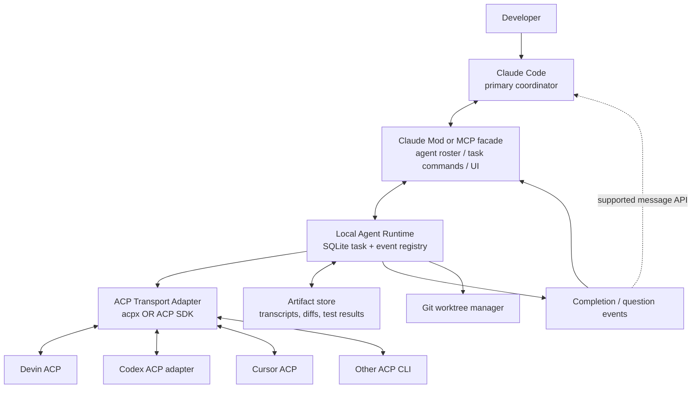

# Universal ACP Subagents for Claude Code — Research & Architecture Seed

**Research checkpoint:** 2026-10-19\
**Status:** Discovery complete enough for an engineering spike; implementation details require local validation.\
**Purpose:** Bootstrap a local Codex project that integrates persistent, multi-provider coding agents into Claude Code as native-feeling asynchronous subagents.

## 1. Product intent

Claude Code is the **primary user-facing coordinator**, but its usage quota is precious. The developer already has access to other coding agents (especially Devin CLI; potentially Codex, Cursor, Gemini CLI, OpenCode, etc.) with distinct models and usage pools. Delegate bounded work to those agents while keeping the main Claude interface, agent awareness, progress reporting, and verification.

**Important:** This is **local CLI orchestration only**. No Devin Cloud sessions, browser automation, remote development, hosted orchestrator, or required cloud service. The external agents may themselves call their normal model endpoints.

Desired workflow:
1. User asks Claude to perform development work.
2. Claude discovers configured workers with model/capability/status/cost metadata.
3. Claude starts a task on a named, **persistent** worker session, immediately receives a task ID, and continues its own work.
4. Worker runs for minutes or hours. It can stream progress, ask for clarification, be steered, and survive normal UI reconnects where backend capabilities allow.
5. Claude receives **small, relevant events** (blocked, completed, failed, budget exceeded), not a giant stdout response or transcript.
6. Full logs, test output, diffs and transcripts are persisted as artifacts and fetched selectively.
7. Claude reviews changes, verifies tests, and integrates isolated worktree commits or patches when appropriate.
8. Workers can collaborate through controlled, durable messages; no unlimited delegation loops.

## 2. Non-negotiable requirements

- **Claude-first:** Claude Code retains the primary conversational UI.
- **Multi-provider:** no hardcoding Devin. Configurable ACP backend executable and args; prebuilt profiles for Devin, Codex, Cursor and other supported agents.
- **Persistent conversations:** `agentId` identifies a durable conversation; `taskId` identifies one job/turn. Different tasks may use the same agent session.
- **True background jobs:** launching a task cannot tie up a Claude tool call for the duration; do not rely on `acpx --no-wait` alone without checking its exact semantics.
- **Bidirectional messages:** Claude can delegate/steer; workers can request clarification and report completion. Distinguish actual unsolicited delivery from queued messages that need polling.
- **Bounded context:** tool calls and notifications are compact. Big outputs go to disk with references and pagination.
- **Resumability:** distinguish surviving a Claude UI restart, surviving the bridge daemon restart, and recovering a native ACP session after backend process death. Record actual capabilities per backend.
- **Security:** explicit workspace access/permission handling, safe subprocess spawn, no implicit auto-approval of risky actions, no secret leakage, trust boundaries between agents.
- **Scope control:** one owner per task, finite review cycles/delegation depth, deterministic acceptance criteria, and independent verification.
- **Usage attribution:** track provider/model/session/task cost when possible. Never assume ACP token metadata equals invoice costs or that different plans share a quota.

## 3. Verified building blocks

### Claude Code Mods

Anthropic documents Mods as JS/TS plugin hooks that run inside Claude Code and can add panes, commands, tool registrations, change UI, intercept tool calls, start processes and send messages to another session. Mods run with user privileges and are **not sandboxed**. The docs as checked describe CLI v2.1.287+ for Mods. Exact APIs and permissions must be checked against the locally installed version.

- https://code.claude.com/docs/en/plugins/mods/overview
- https://code.claude.com/docs/en/plugins/mods/reference
- https://code.claude.com/docs/en/cross-session-messaging

**Unverified / critical gate:** `$.agent.register` or equivalent Mod hooks may not allow attaching an arbitrary ACP runtime as an actual native Claude subagent. A Mod can certainly provide a **native-feeling** agent pane, lifecycle commands, notifications and tools. Do not claim the external agent enters Claude's actual subagent registry until tested locally. If unsupported, expose clean custom tools plus UI, or an MCP fallback.

### Claude Code cross-session messaging

Anthropic documents peer-session messaging with native session inbox behavior and messaging integration. It is relevant to waking a Claude coordinator, but exact host/session constraints, authentication and token propagation must be tested; never hard-code undocumented socket framing. Prefer documented APIs rather than directly reverse engineering private protocols.

- https://code.claude.com/docs/en/cross-session-messaging

### ACP (Agent Client Protocol)

ACP provides standardized JSON-RPC-over-stdio agent initialization, session creation, prompts, incremental updates, cancellation and optional capabilities such as session loading. ACP is a **client↔agent protocol**, not automatically a durable inter-agent message bus or task scheduler. Always negotiate capabilities; `session/load` and session/list may not exist on every provider.

- https://agentclientprotocol.com/
- https://agentclientprotocol.com/protocol/session-setup

### acpx

`openclaw/acpx` is a headless ACP client. Its documentation confirms named persistent sessions, prompts on existing sessions, queued messages, local metadata, history, JSON output and configurable agent commands. Caution: `--no-wait` is documented as queue acknowledgement when the session is **already busy**; it is not a substitute for our daemon-managed background process. acpx is pre-1.0/evolving: pin a tested version and put it behind an adapter.

- https://github.com/openclaw/acpx
- https://github.com/openclaw/acpx/blob/main/docs/CLI.md
- https://github.com/openclaw/acpx/blob/main/docs/agents.md

**Design question:** use acpx as transport/session manager, OR directly use `@agentclientprotocol/sdk` for better streaming/event/control integration. Avoid two conflicting sources of session truth. Prototype both briefly and choose one.

### Devin CLI

Devin CLI documentation includes `devin acp`, noninteractive CLI commands, local session handling and configurable models. Verify installed version, exact model identifiers, ACP recovery support and usage entitlement locally.

- https://docs.devin.ai/cli/reference/commands

### Cursor CLI

Cursor documents `agent acp` with stdio JSON-RPC, `session/new`, `session/load`, `session/prompt`, updates, permission requests, and cancel.

- https://prod.cursor.com/docs/cli/acp

### Codex CLI and others

ACP support for Codex can involve third-party or experimental adapters, depending on CLI version. Do not assume every CLI binary exposes the same native ACP flags. Resolve via the current acpx agent registry or relevant official adapters, and smoke-test launch/auth/resume.

- https://github.com/openclaw/acpx/blob/main/docs/agents.md

## 4. Existing projects to inspect (do not blindly assemble them)

| Project | What it contributes | Gap / caution |
|---|---|---|
| [acpx](https://github.com/openclaw/acpx) | Generic ACP transport, named sessions, queue, history | Not a full Claude native subagent lifecycle or proactive event bridge |
| [devin-subagents](https://github.com/Duro02/devin-subagents) | MCP `spawn`, `wait`, steering, lifecycle, persistence for Devin ACP | Devin-centric; verify implementation/security and whether metadata survives crashes |
| [open-agent-bridge](https://github.com/kevinArgueta96/open-agent-bridge) | Live cross-CLI discovery, SQLite messaging, Claude native inbox and Codex integration | Different problem emphasis: communication, not necessarily managed ACP execution for arbitrary workers |
| [claude-codex-mcp-bridge](https://github.com/WebisityStudio/claude-codex-mcp-bridge) | Durable async handoffs, bounded outputs, worktree concepts | Codex-specific; verify project maturity |
| [Open Multi-Agent](https://github.com/open-multi-agent/open-multi-agent) | External ACP agents in task DAGs and orchestration | Larger harness than necessary; avoid adopting extra workflow bureaucracy |
| [Goose](https://github.com/block/goose) | ACP/MCP-capable full coding agent platform | An extra agent framework; not essential when Claude stays the UI |

**First research task:** clone/read the relevant parts of these repos, assess licenses, maintenance, actual supported versions, tests, and potential reuse. Prefer a coherent thin solution over stacking several daemons which all own session state.

## 5. Proposed architecture



Boundaries:
- **Claude facade:** commands/tools, status pane, readable roster, compact events, Claude version compatibility.
- **Runtime:** durable queue/task state machine, worker processes, session mappings, event log, timeouts, permissions, limits, artifact indexing.
- **Transport:** swappable ACP client implementation; normalize protocol events and negotiate capabilities.
- **Provider profiles:** executable, args, env names, optional model/capability overrides, auth readiness.
- **Workspace manager:** separate worktrees for writable parallel jobs; read-only mode for research/review.

Don't make the runtime dependent on Claude Code being open. Conversely, do not pretend an exited Claude session can respond until it resumes or an explicit agent runner starts it.

## 6. State model

**Agent session**: `registered` → `starting` → `ready` ↔ `busy` → `suspended` / `recovering` / `unavailable` / `terminated`.

**Task**: `queued` → `running` → `blocked_on_input` / `verifying` → `completed` / `failed` / `cancelled` / `timed_out`.

**Event types**: `task.started`, `task.progress`, `task.question`, `task.blocked`, `task.completed`, `task.failed`, `task.cancelled`, `agent.disconnected`, `agent.recovered`, `budget.warning`, `verification.failed`.

Event envelope:

```json
{
  "eventId": "evt_...",
  "taskId": "task_...",
  "agentId": "devin-backend",
  "type": "task.blocked",
  "timestamp": "2026-10-19T19:00:00Z",
  "summary": "Breaking API decision required",
  "artifactRefs": ["artifact://task_.../analysis.md"],
  "requiresReply": true
}
```

These are proposed schemas, **not** standard ACP messages.

## 7. Configuration proposal

`agents.yaml` should describe logical workers and map them to ACP provider profiles. This is an application-specific schema, not native acpx config.

```yaml
version: 1
runtime:
  stateDir: .agent-bridge/state
  artifactDir: .agent-bridge/artifacts
  maxConcurrentTasks: 4
  output:
    maxInlineChars: 6000
    progressMinIntervalSeconds: 30
  taskDefaults:
    maxRuntimeMinutes: 120
    maxReviewRounds: 2

providers:
  devin:
    transport: acp
    command: devin
    args: [acp]
    model: auto
  cursor:
    transport: acp
    command: agent
    args: [acp]
  codex:
    transport: acp
    # Resolve official or community adapter based on installed version.
    command: codex-acp
    args: []

agents:
  backend-implementer:
    provider: devin
    description: Scoped implementation and tests
    session: persistent
    workspace: isolated-worktree
    approvalMode: ask
  reviewer:
    provider: codex
    description: Read-only code review and validation
    session: persistent
    workspace: read-only
  frontend:
    provider: cursor
    description: UI implementation
    session: persistent
    workspace: isolated-worktree

routing:
  defaultAgent: backend-implementer
  requireExplicitApprovalFor:
    - cross-repository-access
    - destructive-operations
    - external-network-exfiltration

governance:
  maxDelegationDepth: 1
  maxAutomaticRevisions: 2
  maxPendingQuestions: 10
  verifyBeforeAccept: true
```

**Never blindly interpolate config values into a shell command.** Spawn executables using an argument array and an allowlist/trust model for configured commands.

## 8. Claude-facing API (proposed)

- `agents.list({capability?, availableOnly?})` — discover logical agents and backend capabilities.
- `agents.spawn({agentId, prompt, cwd?, taskKey?, background:true, acceptanceCriteria?})` — return `{taskId,status,agentId}` quickly.
- `agents.status({taskId})` — get compact state and last update.
- `agents.steer({taskId,message})` — queue a follow-up instruction for a running task if supported.
- `agents.reply({taskId,questionId,message})` — unblock a question.
- `agents.wait({taskIds,timeoutMs?,until?})` — optional bounded blocking wait, never default for long jobs.
- `agents.events({afterCursor?,limit?})` — durable event inbox.
- `agents.result({taskId,include?,maxChars?})` — bounded summary and references.
- `agents.artifact({ref,offset?,limit?})` — paginated access to large logs/transcripts.
- `agents.cancel({taskId})` — best-effort interruption with explicit final state.

Register via Claude Mod *if the local API supports the relevant tool/notification semantics*, otherwise MCP server with exactly the same logical API. The runtime should not care which facade is used.

## 9. Observability / evaluation

Instrument at least:
- time from dispatch → accepted → first progress → completion;
- number of Claude turns/tokens consumed in supervision (where observable);
- worker provider/model credits/tokens/cost when verifiable;
- number of clarification messages and retries;
- test/verification pass rate, changed files, blast radius;
- lost/replayed events, task recovery success;
- coordinator context inflation (inline output sizes).

Compare three real coding tasks under (A) Claude-only, (B) Claude→Devin via simple CLI, (C) Claude→persistent ACP bridge. Goal is demonstrable quota relief **without** unacceptable correctness or review overhead.

## 10. POC sequence and stop/go gates

**Gate 0 — Environment:** inspect `claude --version`, `devin --version`, `codex --version`, `agent --version`, installed npm/node/pnpm, and auth (without printing tokens); document missing dependencies. Do not assume all tools are installed.

**Gate 1 — Native Claude integration feasibility:** create a minimal test Mod registering a tool and event/status UI. Examine whether an arbitrary external ACP agent can really become a native Claude subagent identity. Record supported vs unsupported behavior. If Mod constraints block development, continue with MCP facade, not a bespoke hack.

**Gate 2 — One persistent worker:** implement Devin ACP and two prompts in the same named session. Verify context retention and actual backend recovery behavior. If Devin unavailable, use an ACP mock or whichever installed agent is available.

**Gate 3 — True background execution:** `spawn` returns quickly, worker stays alive, `status` and `steer` work, full output persists, compact event arrives when done.

**Gate 4 — Recovery:** restart Claude Code, then restart runtime; verify which work/session state recovers and exactly which does not. Avoid false guarantees.

**Gate 5 — Multi-provider:** add Codex/Cursor profile without changing runtime APIs; test capability negotiation and unsupported feature fallback.

**Gate 6 — Controlled collaboration:** Devin sends blocked question; Claude receives it and replies; no uncontrolled ping-pong; verify retry caps, task ownership and isolated workspaces.

Deliver a runnable TypeScript POC, tests, example config, a capability matrix, reproducible manual demo and a concise design decision record.

## 11. Non-goals for version 1

- Replacing Claude Code as the UI or forking Claude Code.
- Running models locally or building an inference engine.
- Devin Cloud, remote compute, SaaS hosting.
- A full autonomous organization of agents, elaborate planner, task DAG framework, or heavyweight agent civilization.
- Guaranteeing universal ACP persistence where the backend does not expose it.
- Pretending a custom Mod agent pane is necessarily Anthropic's native Task/subagent machinery.
- Spending large model quotas simply to validate orchestration.

## 12. Research links / confidence

Primary documentation:
- Claude Mods: https://code.claude.com/docs/en/plugins/mods/overview
- Claude Mods reference: https://code.claude.com/docs/en/plugins/mods/reference
- Claude peer messaging: https://code.claude.com/docs/en/cross-session-messaging
- ACP: https://agentclientprotocol.com/
- Devin CLI: https://docs.devin.ai/cli/reference/commands
- Cursor ACP: https://prod.cursor.com/docs/cli/acp
- acpx CLI: https://github.com/openclaw/acpx/blob/main/docs/CLI.md

Community codebases requiring local code review:
- https://github.com/openclaw/acpx
- https://github.com/Duro02/devin-subagents
- https://github.com/kevinArgueta96/open-agent-bridge
- https://github.com/WebisityStudio/claude-codex-mcp-bridge
- https://github.com/open-multi-agent/open-multi-agent
- https://github.com/block/goose

**Confidence discipline:** Mark each important feature as `verified in upstream docs`, `verified locally`, `proposed`, or `unsupported`. Fresh documentation and actual local CLI capabilities trump this seed. If a prior discussion claimed native `$.agent.register` can host any ACP runtime, treat that as **unproven** until confirmed experimentally.
