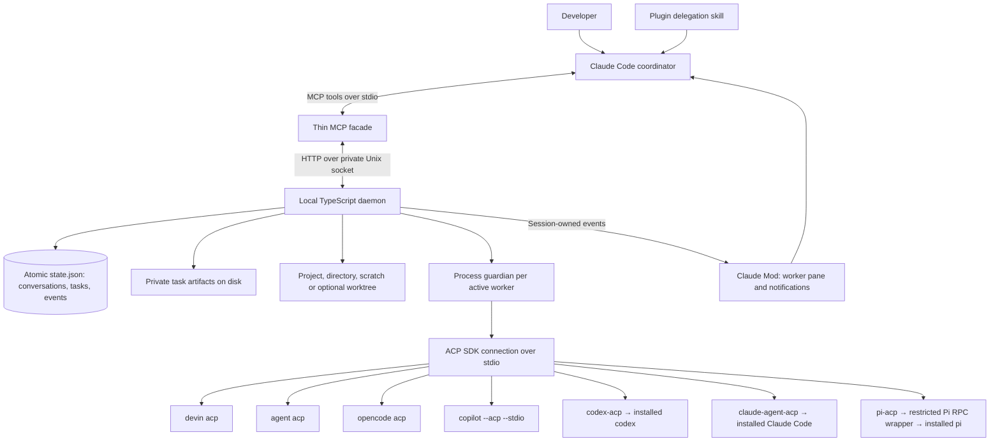
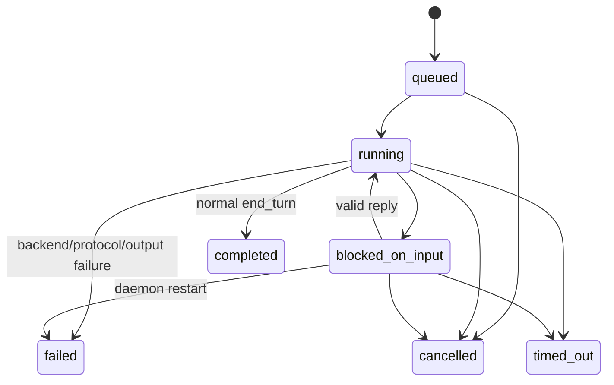

# Architecture

The primary product entry point is now the [Claude Code plugin](CLAUDE_PLUGIN.md): delegation skill, auto-starting MCP facade and Mod pane/notifications. The manual daemon API described below remains available for advanced use.

Agent Bridge lets Claude Code delegate to local CLI agents while retaining the main conversation. One daemon owns the workers and their persistent conversations. Claude reaches it through MCP; the daemon reaches each worker through **Agent Client Protocol (ACP)**. The implementation reuses the ACP and MCP SDKs, plus existing Pi, Codex and Claude adapters.

## What runs when you delegate

1. You invoke `/agent-bridge:delegate devin <task>` or ask Claude naturally to use Devin. The skill gives Claude instructions for choosing a worker, writing a bounded task and reviewing its result.
2. Claude calls the plugin's MCP tools. The plugin finds your project and starts or reconnects its detached runtime automatically.
3. For ordinary work, `agents_run` dispatches and waits within one foreground MCP call. Explicit background work uses `agents_spawn`, which returns a handle immediately. The runtime opens a fresh conversation for a new task; only explicit follow-ups resume an existing one. Workers use the current project folder by default; alternate folders, scratch folders and explicitly requested worktrees are supported.
4. The CLI runs using its existing authentication/model settings. Large output, transcripts and diffs stay in project-local artifacts; Claude receives compact status and summaries.
5. The Mod shows a compact progress line and an optional numbered inspector. Only background tasks submit completion/question events to the originating session. Foreground results return in the tool call; handled results suppress later notifications.
6. Claude retrieves the result, reviews the actual changed workspace and independently runs acceptance checks. Integration is a separate deliberate step.

The skill is instructions, MCP is the callable interface, the daemon owns execution, and the Mod supplies UI/notifications. External agents do not need a Claude proxy conversation around each task.

## Protocol choice: Agent Client Protocol and A2A

Two unrelated protocols use the abbreviation ACP:

| Protocol                                    | Role                                                                            | Project decision                                                        |
| ------------------------------------------- | ------------------------------------------------------------------------------- | ----------------------------------------------------------------------- |
| Agent **Client** Protocol                   | Client-to-coding-agent sessions, prompts, updates, permissions and cancellation | Current worker connection; implemented and tested with seven local CLIs |
| Agent **Communication** Protocol, IBM/BeeAI | Interoperability between independent agent systems                              | Merged into A2A; this project does not use it                           |
| A2A, Agent2Agent                            | Discovery and task/message exchange between independent agent services          | Future optional provider connection; not implemented                    |

The [official merger announcement](https://lfaidata.foundation/communityblog/2025/08/29/acp-joins-forces-with-a2a-under-the-linux-foundations-lf-ai-data/) concerns Agent Communication Protocol. It does not supersede the [Agent Client Protocol](https://agentclientprotocol.com/get-started/introduction) used here. Agent Client Protocol also targets remote scenarios; the reason to retain it is the installed coding agents' tested interface, not a blanket local-versus-remote distinction.

Our decision is to retain ACP for CLI workers and consider A2A when a useful agent exposes an A2A endpoint. A2A would be an additional connection behind the existing Claude tools, not a replacement for the plugin or automatic session recovery. See the [A2A documentation](https://a2a-protocol.org/latest/topics/what-is-a2a/) and [future-feature scope and acceptance gates](ROADMAP.md).

## Components and process boundaries



The guardian is the provider process's parent; the daemon holds its stdio pipes. On daemon death the input pipe closes and the guardian terminates the process group. Tests exercise an actual daemon SIGKILL and check that the mock child exits. A provider deliberately detaching its own processes is outside this guarantee.

The daemon is independent of Claude and the MCP facade. Closing Claude's tool connection does not close the worker. Normal operation has one daemon per project config and one process tree per logical worker in use, rather than one process per prompt.

| Module                         | Responsibility                                                                                        |
| ------------------------------ | ----------------------------------------------------------------------------------------------------- |
| `src/config.ts`, `agents.yaml` | Validate trusted provider commands, environment, workspace policy and limits                          |
| `src/executables.ts`           | Resolve installed CLIs and explicit adapter paths without a shell; avoid npm dependency shadowing     |
| `src/project-config.ts`        | Create a project config with absolute adapter paths; refuse to overwrite a config                     |
| `src/plugin.ts`                | Discover the project, atomically create default config and auto-start/reconnect the runtime           |
| `skills/`, `hooks/register.js` | Claude delegation instructions, worker pane and session-owned event notifications                     |
| `src/server.ts`                | Exclusive daemon lock, local mode-0600 socket, bounded requests and shutdown                          |
| `src/runtime.ts`               | Queue, ownership, tasks, pending questions, event inbox, recovery and artifact indexing               |
| `src/acp.ts`                   | ACP SDK connection, capability negotiation, session create/load, prompts and cancellation             |
| `src/workspaces.ts`            | Validate workspace modes and canonicalize existing directory selections                               |
| `src/models.ts`                | Normalize legacy ACP models and modern categorized config options                                     |
| `src/worker-host.ts`           | Process-group lifecycle and cleanup after pipe closure                                                |
| `src/store.ts`                 | Durable state snapshots and bounded private artifact files                                            |
| `src/run.ts`                   | Bounded foreground coordination over existing daemon calls, MCP progress and cancellation             |
| `src/mcp.ts`                   | Eleven Claude-facing tools, including foreground run and bounded wait; no transport/session ownership |
| `scripts/pi-readonly.mjs`      | Restrict Pi tools, disable executable extensions/MCP, surface otherwise swallowed model errors        |

## Identities and durable state

These are separate concepts:

- **provider**: executable/adapter configuration, such as `devin` or `codex`.
- **agentId**: configured logical worker, such as `devin-worker`. Each conversation of a worker gets its own process; turns within a conversation serialize, and separate conversations run in parallel.
- **agentSessionId**: bridge conversation ID bound to a worker and workspace; persists across tasks and daemon restarts. Pass it on follow-up dispatches.
- **nativeSessionId**: the backend's ACP conversation ID. The bridge stores the mapping and checks load support.
- **taskId**: one job, including up to two queued steering turns. A later job gets another taskId and fresh context by default; an explicit follow-up passes agentSessionId to retain the selected conversation.
- **eventId / cursor**: immutable event identity and ordered inbox position. Each coordinator stores its own cursor.
- **artifact reference**: `artifact://task_<uuid>/output.txt`; resolves only through the bounded artifact API.

State is under `runtime.stateDir`, default `.agent-bridge/`. `state.json` contains conversation metadata, compact tasks and events. An exclusive lock prevents normal concurrent writers. Saves fsync a temporary file, rename it over the snapshot, and fsync the directory. Artifacts append separately. This supports process-restart durability, but is not a cross-file power-loss transaction or an exactly-once side-effect guarantee. Whole-state rewrites and unpruned event history are acceptable for this prototype; SQLite is the next storage step if scale demands it.

## Explicit background task flow

```mermaid
sequenceDiagram
  participant C as Claude via MCP
  participant D as Daemon
  participant A as ACP worker
  C->>D: spawn(agentId, prompt, workspace?, agentSessionId?, taskKey?)
  D->>D: Persist task + queued event
  D-->>C: taskId, status=queued
  D->>A: initialize + session/new or session/load
  D->>A: session/prompt
  A-->>D: Stream updates
  D->>D: Append artifacts; throttle progress events
  A->>D: Permission/input request, if supported
  D->>D: Persist blocked event and questionId
  C->>D: events(afterCursor)
  D-->>C: Compact event + question reference
  C->>D: reply(questionId, content/optionId)
  D-->>A: Resolve pending ACP request
  A-->>D: Prompt response
  D->>D: Persist terminal task + event
  C->>D: result(taskId)
  D-->>C: Bounded summary + artifact references
```

Dispatch persists before scheduling and returns without waiting for the model. The live tests observed dispatch in tens of milliseconds. `maxConcurrentTasks` bounds simultaneous tasks; turns within one conversation serialize, while separate conversations on the same agent run in parallel. At most one idle process per agent is kept. A caller-supplied taskKey de-duplicates dispatch for that agent. Omit it for a new job, or reuse it when retrying a lost dispatch response.

Actual task states:



A successful backend turn means execution ended. `verification` stays `pending`; the coordinator independently checks acceptance criteria. Refusal, token limits and other non-success stop reasons fail explicitly. `steer` is a queued next-turn instruction, not guaranteed mid-turn injection. Two follow-ups are allowed per task; there are no automatic review loops.

## Persistence and recovery

| Boundary                               | Behavior                                                                                                                  |
| -------------------------------------- | ------------------------------------------------------------------------------------------------------------------------- |
| Claude/MCP disconnect                  | Background tasks continue; an open foreground MCP request cancels its task on protocol EOF/abort                          |
| Daemon graceful stop or crash          | Recorded history survives; interrupted tasks fail; queued tasks resume                                                    |
| Native backend replacement             | Explicit follow-up uses session/load only if advertised; native context restoration passed for all seven tested providers |
| Unsupported/failed native load         | Fail explicitly; no silent new conversation or prompt replay                                                              |
| Pending question during daemon restart | Task fails and question becomes invalid; an in-memory ACP request cannot be restored                                      |
| Interrupted file/tool operation        | No automatic retry or exactly-once guarantee; coordinator inspects workspace before retrying                              |

Historical updates emitted during native load are written to `recovery.jsonl`, not attributed to the new task's output. Native session restoration is distinct from resuming a running tool operation.

## Permissions, workspaces and context

Workers use the project folder by default, without Git setup. Project mode includes current uncommitted files, and authorized edits are immediately visible in the checkout. The delegation skill carries relevant user/project instructions and scope into worker prompts and coordinates overlapping writes. External CLIs do not automatically inherit Claude's loaded rules or permission configuration.

`agents_spawn.workspace` selects `project`, `directory` (existing canonical path), `temporary` (fresh private scratch folder), or `isolated-worktree` (explicit isolation from committed HEAD). Omit the field to use the configured profile default; shipped writable profiles now default to `project`, and the skill selects project explicitly for ordinary new tasks, including with older generated configs. The legacy `read-only` profile still uses the project folder and requires provider-side read restrictions.

A conversation remains bound to its workspace. Every new task creates fresh context, including in the same canonical directory; only an explicit `agentSessionId` resumes. Each new temporary task creates a new scratch folder. Follow-ups omit `workspace`. Each conversation runs in its own worker process; resuming a conversation whose process was evicted starts a new process and loads the selected native session, failing explicitly if load is unsupported. A process never handles two conversations, so separate conversations can run concurrently. Task status/results include the selected workspace and resolved `cwd`; `agents_list` exposes conversation IDs/folders for discovery. Existing state keys and conversation fingerprints remain compatible; old worktree conversations can be continued explicitly by ID.

Scratch folders persist under `.agent-bridge/scratch/<agentSessionId>/`. The bridge never deletes them automatically. Explicit worktrees live under `.agent-bridge/worktrees/<agentSessionId>/`; only they require Git HEAD, generate `diff.patch` and record Git workspace status. Worktree patches cover tracked changes relative to HEAD; untracked files are listed separately. The coordinator controls integration. Project/directory/scratch modes do not attempt Git operations or manufacture a diff artifact.

ACP client filesystem and terminal delegation are disabled. Providers perform their own operations using their own settings. If a provider sends an ACP permission request, the bridge blocks until an explicit `allow_once` or `reject_once` response; permanent approvals are rejected. Providers may internally allow some workspace edits without sending an ACP request. The Copilot live fixture exercised a real once-only edit permission; deterministic tests also cover generic permission handling.

Pi is configured as `pi-reviewer`, with only `read`, `grep`, `find`, `ls`; extensions, MCP, skills, prompt templates and context-file loading are disabled in its RPC subprocess. It uses the user's corrected default model unless `BRIDGE_PI_MODEL` is explicitly configured. Pi's older adapter can swallow model failures; the thin RPC wrapper detects assistant error messages and terminates the failed process. This preserves reuse without forking the adapter. Its startup banner can still mention resources enumerated by the adapter; executable Pi extensions remain disabled.

A read-only profile is a provider-side tool restriction, not an OS filesystem sandbox. Worktrees are also not sandboxes. Configured executables and provider configurations are trusted code. The daemon uses argument arrays rather than shell command strings and inherits only basic process variables plus configured `envNames`/`env`. Known secret values receive best-effort redaction, not universal secret detection.

Logs, streamed output, usage updates, permission details and diffs stay in artifacts. Results cap inline summaries; artifact reads use bounded byte pages. Model discovery supports both legacy `models` and modern `configOptions`. Usage is labeled provider-reported session metadata, not task invoice cost. Multiple CLIs may use the same model account and quota.

## Claude integration and limits

MCP is the supported facade. The local Mod spike proved custom tool/command/status hooks, but did not attach arbitrary ACP runtimes to Claude's native subagent registry. No native-subagent identity is claimed. The shipped Mod polls the durable event inbox and submits compact events into the originating Claude session using documented $.prompt.submit. Without the Mod, the facade provides bounded waits/status polling. Reads are replayable; the caller advances its cursor only after handling the events and de-duplicates by eventId.

There is no hosted orchestration service, Devin Cloud, planner framework, task DAG, automatic merge or agent-to-agent message bus. See [ADR-001](ADR-001-runtime.md), [provider research and live evidence](PROVIDERS.md), and [usage](USAGE.md).

## Plugin packaging

The root .claude-plugin/plugin.json, .mcp.json, skills/ and hooks/ form a loadable/installable Claude Code plugin. src/plugin.ts creates a private project config and auto-starts/reconnects the detached daemon. hooks/register.js owns session-specific watched tasks and queued notifications in Claude's plugin store, renders the worker pane and uses documented Unix-socket HTTP and prompt APIs. Plugin worker processes are marked AGENT_BRIDGE_WORKER=1 so an external Claude worker cannot recursively start delegation. Thirty-three offline tests plus Mod-host tests cover the integration; live Claude-to-Pi evidence is recorded separately.

## Activity visibility and review diagnostics (0.3.1)

ACP tool_call/tool_call_update messages update a bounded eight-entry recentActivity list and latest activity timestamp on the task. Public message chunks continue to feed the bounded output tail and output artifact. Internal thought chunks are not promoted into this UI. The Mod polls compact status every two seconds and renders folder, latest activity, recent tools and public output through `/workers <taskId>`; providers may report incomplete activity. Explicitly viewing another task does not change completion-notification ownership.

Completed events use a lifecycle message instead of cutting a random report fragment into the user conversation. Results label their inline text as bounded-output-tail and expose fullOutputRef/outputBytes. The skill requests concrete review evidence and instructs Claude to read report pages from offset 0 and verify significant findings. A single in-flight notification guard prevents overlapping timer/turn-complete flushes from submitting the same batch concurrently.

The reused worker stderr callback now interrupts the current Active task rather than its creation-time task. State loading validates required structure and task/session/event references; invalid state is preserved with a recovery diagnostic rather than silently reset. Daemon spawn errors surface their actual cause promptly. Existing valid state remains compatible.

## Workspace identity checks (0.4.0)

Project and directory sessions pin the canonical path plus filesystem device/inode at dispatch, before queued execution. Scratch/worktree identities are pinned after creation. Before launch, native session create/load and each prompt turn, the runtime rechecks that identity and rejects replacements, including symlink redirects or a different directory at the same path. Legacy sessions without an identity are checked for canonical-path changes before pinning their current directory; a replacement before this first migration cannot be detected retroactively. Checks do not prevent concurrent filesystem changes after validation and are not OS sandboxing.

Outside-project absolute paths, parent-relative paths and initial symlink aliases remain intentionally supported. Regression tests cover intentional outside-folder selection, aliases, replacement after restart and replacement while queued. These checks ship with the foreground/usability changes in 0.4.0.

## Foreground delegation and optional inspection (0.4.0)

agents_run is a small MCP-facade coordinator over spawn/wait/result, not a second session/task owner. It waits up to 45 seconds and returns a result or input request; subsequent calls pass taskId alone to keep waiting. It sends bounded MCP progress when a token is supplied. Client abort and stdin EOF close the protocol and cancel the in-flight task. The SDK stdio transport does not close itself on EOF, so the facade handles EOF explicitly. The Mod also cancels tracked foreground tasks on parent-turn interruption/session end. Background spawn remains detached.

New tasks create fresh sessions. Explicit agentSessionId follow-ups reuse the original session and workspace, including legacy state. The first stored session retains the legacy per-agent key for compatibility; later sessions use unique keys. Roster output caps listed conversations at ten and includes bounded active-task metadata for progress correlation.

The Mod correlates an open foreground call using a tool-call taskKey, discovers its task from the roster, and updates compact UI through documented APIs. No inspector opens automatically. Foreground events never submit completion prompts; background terminal results read by the caller are marked handled in the originating session's plugin store, suppressing later notifications without claiming independent acceptance. Background submission remains a documented plugin prompt, not native Agent completion.

The optional inspector uses numbered tasks and pages public output from byte zero with next/previous navigation, cancellation and close. Full tool transcripts remain out of normal coordinator context. Results include output, outputComplete and nextOutputOffset; the old summary field remains explicitly labeled a tail. Twenty-nine offline tests and six Mod-host tests cover runtime and UI contracts. Exact provider behavior is verified separately with live smoke tests.

## Live activity, panel formatting and artifact I/O (0.4.1)

AbovePrompt renders a bounded activity block automatically for owned active work, with tool names, sanitized file paths and elapsed time. Paths come from ACP locations or recognized path fields in rawInput; tool output and internal thought chunks are not promoted into the activity block. The block yields to surveys and preserves other band content. The detailed Pane uses documented Box/Text styles, the engine's Markdown renderer and native Button constructors via ui.resolve. Active-task inspection follows the public-output tail; Pause switches to report pages from byte zero, Watch resumes following, and completion switches to the beginning of the final report. Buttons/hotkeys provide navigation/cancellation/close. Byte offsets and artifact URIs are internal.

Artifact reads, metadata and appends now use shared descriptor-based Store methods. Leaf files are opened with O_NOFOLLOW and checked by fstat for private regular-file shape, rejecting hard links as well as symlinks. Artifact/task directories are checked for symlink redirection, and internal prompt reads use the same descriptor path. This addresses reproducible static link redirection, not an OS sandbox against same-user code or every ancestor replacement race. The state/log/config paths are not covered by a blanket artifact-I/O guarantee.

Foreground run results include waitExpired when a bounded call returns unfinished work; this is separate from a task deadline. Regression coverage is 33 offline tests and 9 actual Mod-host tests, including native Markdown/button rendering, narrow panel layout and live-to-report navigation.

## Inspector navigation (0.4.2)

Each newly observed owned active task opens the existing native Pane once in interactive sessions, without requesting focus. The shown-task set is persisted, so a manual close is respected on subsequent polls. A native Button in AbovePrompt explicitly opens/focuses the inspector and remains after completion. This explicit user input matters: Claude Code defers unsolicited panes at narrow widths. The Mod does not bypass the engine's layout/focus policy or register external workers in its native transcript list. All tasks returns to numbered task selection. A paused report selection is preserved when another task starts.

Conversation reuse remains explicit at the runtime boundary: a follow-up supplies agentSessionId; a fresh task omits it. The delegation skill resolves natural-language follow-ups and same/fresh-session instructions, recovering missing references from recent worker sessions when unambiguous. The runtime does not silently route all work for a provider to its latest conversation.

## Named conversations and retained task history (0.4.4)

Runtime sessions persist workerName derived from the first task description and profile name. Unrelated sessions reserve unique names; follow-ups copy the same name to their task metadata. Older state gets names on runtime startup without changing conversation/task IDs or native session IDs. Names are surfaced in roster session entries, active task metadata and compact status/results. Profile agentId still selects a harness; workerName identifies one conversation and is resolved to agentSessionId by the coordinator.

The Mod persists an append-only conversation slot index per Claude session and groups owned task IDs by agentId/agentSessionId. Semantic names are the visible identity, while numeric shortcuts refer to fixed slots for compatibility. Each conversation opens its latest active task or latest completed task, and Task history links earlier reports by name/task index. Reload hydrates missing owned tasks once in addition to refreshing active/recent/selected tasks; completed history is no longer lost due to the five-task polling window. Runtime history survives independently of UI ownership.

## Navigation workspace (0.5.0)

The inspector distinguishes overview state from selected task state, so visiting the overview does not delete the reading target. Per-task reading metadata stores offset/page history/live-follow; per-conversation metadata stores its last visited task. Selecting an owned task saves the previous view, restores the target's state and reads its artifact page. New task discovery opens the overview only for a first visit; it never changes an existing reading target. Worker rows represent a running/input task before queued tasks, otherwise the latest task.

Native Select controls expose workers throughout overview/history/detail and tasks in detail. Native Input filters overview cards without reducing the worker selector. Adjacent-worker and pending-input actions resolve through the same command handler. Cancel from overview/history requires selecting a task first. Mobile uses the existing worker/history buttons where Input/Select are unavailable. The band provides direct worker access and a consistently counted overview action. No model call, execution permission or notification subscription is introduced by switching views. Details and scope: [Worker navigation](WORKER_NAVIGATION.md).

## Pane state and composer priority (0.5.2)

A single persisted screen discriminant replaces overlapping overview/history flags. Per-task reading state remains separate from screen selection. Commands serialize navigation; close increments a generation to invalidate pending opens. Rendered action closures bind task/page identity, and artifact reads use session/request generations to discard stale responses. UI invalidation follows state transitions. Detail focus starts on Back rather than a selector; native controls, scrolling and Escape retain host behavior. Worker navigation and artifact paging have separate rows.

AbovePrompt renders active work only and yields to a nonempty composer or native survey. Documented prompt.read/edit/fill hooks observe draft presence without changing draft content; draft text is not persisted. Idle status is cleared. Automatic pane discovery waits while typing, while existing panes and task execution remain intact.

## Next milestone: specialized definitions (proposed)

After interface stabilization, add a definition resolver and capability preflight before the existing worker lifecycle. A versioned agent package supplies behavior, tools/settings requirements and evaluation cases; the configured harness binding produces an inspectable snapshot pinned to a conversation. Existing conversations/tasks/artifacts remain the execution model. Project/global definitions stay separate from runtime state and scoped memory. Claude-led authoring and any companion editor share the same format/API. Native harness facilities are reused; unsupported required features fail explicitly. See [research, package scope and acceptance gates](SPECIALIZED_AGENTS.md). This layer is not yet implemented.
