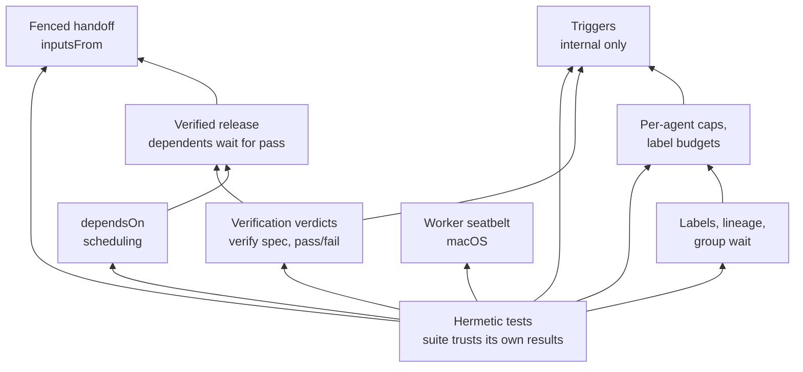
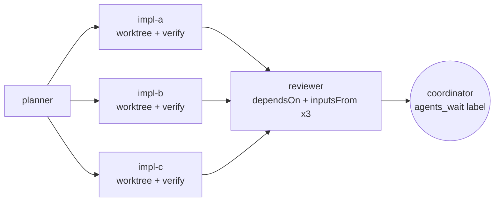
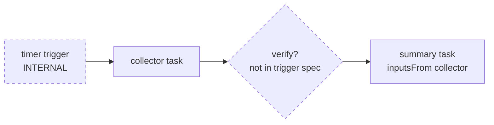
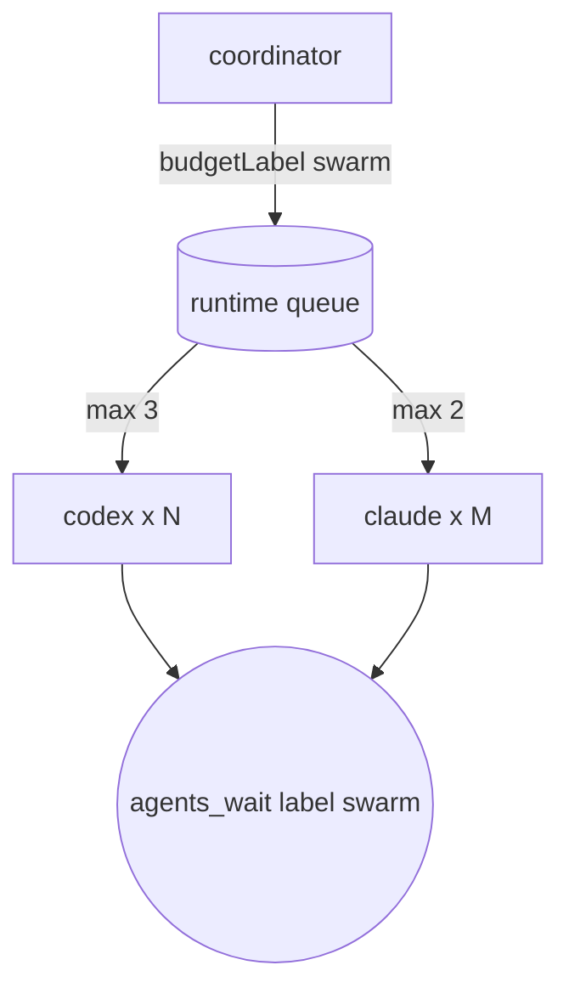
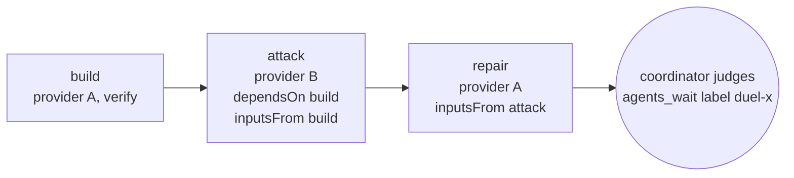

# Agent Bridge PR #11: feature guide

**Date:** 24 October 2026 · **Branch:** `feature/agent-control-plane` (main plus 8 features) · **Companion to:** [the idea lab run report](2026-10-24-idea-lab.md)

The examples use `agents_spawn`, `agents_wait` and `agents_events`, mapped directly to `inputs.spawn`, `inputs.wait` and `inputs.events` in `src/runtime.ts:69-192` by `src/mcp.ts:115-137`. The registration loop prefixes runtime methods with `agents_` except `specialists_schema`, `specialists_validate` and `specialists_catalog`, which retain their names. Separately, `agents_run` uses `runInput` and `runTask` (`src/mcp.ts:12-27`), which call runtime `spawn`, `status`, `wait`, `result` and `cancel` (`src/run.ts:25-71`). Schema references below point to the relevant definitions. Provider and agent IDs such as `codex` and `claude` are placeholders for whatever your `agents.yaml` defines.

---

## 1. What changes for you

| Before this PR | After this PR |
| --- | --- |
| A task counted as "completed" when the worker said it was done. | Your own check (`verify`) runs afterwards, and its pass or fail verdict is stored separately from completion. |
| To pass one task's output to the next, you pasted it into the prompt by hand. | `inputsFrom` pulls earlier output in automatically, fenced and marked as untrusted data. |
| You ordered tasks by waiting and then spawning. | `dependsOn` queues a task until its prerequisites complete and pass any configured verification. |
| You tracked a swarm by listing up to 10 task IDs. | `labels` plus `agents_wait { label }` give you one handle for a whole group, with counts by status. |
| The only limit was one global concurrency cap. | You can cap each agent (`maxConcurrent`) and set a total task budget per label (`taskBudgets`). |
| A full-access worker could reach the bridge's state folder and control socket. | On macOS, an opt-in Seatbelt sandbox blocks both. |
| Every run had to be started by a person. | Timer and event triggers exist **inside the runtime only**. No MCP tool exposes them yet. |

---

## 2. Capability map



Read each arrow as "supports or enables". **Verified release** is where verdicts and `dependsOn` meet: as implemented by commit `f1c052f`, fenced handoff only accepts sources that are "dependency-ready", which means completed and, if a `verify` spec exists, verification passed (`src/runtime.ts:312-317`, `:782-784`).

---

## 3. The features

### 3.1 Hermetic tests

**What it adds.** When the bridge launches a worker, it sets `AGENT_BRIDGE_WORKER=1` (`src/acp.ts:58-60`), and that hides every MCP tool in a worker-mode MCP process (`src/mcp.ts:12-13`, `:115-119`). If the test suite was launched from inside a worker, it inherited this marker, so the CLI under test silently lost its tools and the tests failed for the wrong reason. The test helper now deletes the marker before it starts the child process (`test/helpers/cli-env.mjs:5`).

| Before | After |
| --- | --- |
| `npm test` behaved differently when a worker ran it. | `npm test` gives the same result wherever it runs. |

**Usage.** There is nothing to configure. Plugin CLI tests and selected reliability tests use `test/helpers/cli-env.mjs`; other tests may clear or explicitly set the marker themselves.

**What you can build with it.** (1) A verify step that runs `npm test` inside a worker's worktree. (2) Workers that test their own changes before they report. (3) Builder/attacker duels where the attacker re-runs the suite.

**What it unlocks next.** Every other feature here depends on it, because a `verify` command running inside a worker's environment is only meaningful if the suite is hermetic.

**Defense.**
- *Why the runtime:* the leak comes from the runtime's own recursion guard, so the runtime's tests are the right place to fix it.
- *Rejected alternative:* dropping the guard. That would let workers start more workers.
- *Cost:* a one-line helper.
- *Risk:* a new test might start the CLI without the helper. *Mitigation:* the idea lab caught this exact failure, and the integration notes document it.
- *Limit:* only covers tests that use the helper.

---

### 3.2 Verification verdicts

**What it adds.** `agents_spawn` accepts a `verify` spec: an absolute executable plus literal arguments, run **without a shell** after the worker completes its task turn (the worker process may remain alive). The task stores a separate `verification` field (`pending` → `passed`/`failed` for tasks with `verify`, `src/runtime.ts:997`, `:1603-1655`), plus the exit code, the reason (`exit | timeout | spawn_error | error | restarted | aborted | output_limit | tampered`, `src/verify-verdict.ts:46-54`), an output tail and an artifact (`verification.txt`, `src/runtime.ts:1108`).

At spawn time, before queuing the task, the runtime takes a hash of `package.json`, the lockfiles and `test/` (`src/verify-inputs.ts:4-13`; spawn snapshot at `src/runtime.ts:945-946`). If a worker edits those files to make the check pass, the result is `tampered`, unless the spec sets `allowInputsChanged`. If the runtime restarts while a check is running, that check is recorded as failed and is not replayed (`src/runtime.ts:258-272`).

| Before | After |
| --- | --- |
| "Completed" meant the worker said it was done. | "Completed" plus `verification: passed` means your own command passed. |
| A worker could edit the tests until they passed. | Changes to test or lockfile inputs are flagged as `tampered`. |

**Usage** (schema: `src/verify-verdict.ts:10-41`; field: `src/runtime.ts:126`):

```json
{
  "tool": "agents_spawn",
  "arguments": {
    "agentId": "codex",
    "prompt": "Fix the off-by-one in src/store.ts pagination.",
    "workspace": { "mode": "isolated-worktree" },
    "verify": {
      "argv": ["/usr/local/bin/npm", "test"],
      "envNames": ["PATH", "HOME"],
      "timeoutMs": 60000
    }
  }
}
```

Limits: `argv` takes 1–100 strings, each at most 16000 characters with no NUL; `argv[0]` must be an absolute path. Integer `timeoutMs` ranges from 1 to 60000, default 10000. Optional `envNames` allows up to 100 names matching `[A-Za-z_][A-Za-z0-9_]*`, and `AGENT_BRIDGE_WORKER` is rejected. Optional boolean `allowInputsChanged` has no schema default; omitted behaves as false. `envNames` adds to the baseline environment allowlist (`src/acp.ts:22-38`). An in-process runtime whose own environment has `AGENT_BRIDGE_WORKER=1` rejects `verify`; this does not authenticate socket callers (`src/runtime.ts:754-759`). Worker-mode MCP exposes no tools; Seatbelt is the opt-in socket boundary.

**What you can build with it.** (1) Implementers whose result counts only when `npm test` passes. (2) Lint or type-check gates (`/usr/bin/env`-free, absolute `tsc` path). (3) Personal-assistant jobs where a script checks the output file exists and parses.

**What it unlocks next.** Verified release (3.5), safe handoff (3.3), and triggers that react to verdicts.

**Defense.**
- *Why the runtime:* if the coordinator ran the check itself, it would be one more prompt step that can be skipped or misremembered. A worker grading itself is worse. The runtime runs the check after the worker completes its task turn, using only argv the coordinator supplied (`src/verify-verdict.ts:1`).
- *Rejected alternatives:* a shell string, because of injection risk; letting the worker report its own verdict.
- *Cost:* about 146 lines plus 51 lines of input hashing.
- *Risks:* a verify command can still be weak. Tampering detection compares snapshots at spawn, before the check and after the check; it only covers the listed paths and cannot detect edits restored between snapshots.
- *Limits:* the check runs for at most 60 s, including any wrapper and descendants; a wrapper cannot extend that limit. It runs on the host with an allowlisted environment and is not sandboxed.

---

### 3.3 Fenced handoff (`inputsFrom`)

**What it adds.** A new task can take up to 4 earlier tasks' output, each cut to at most `maxChars` (integer 1–12000, default 4000). All blocks in one prompt share a random fence token, `UNTRUSTED-<16 hex>`, chosen to occur in neither the injected slices nor the coordinator prompt (`src/handoff.ts:19-32`). Each block's header records its source task, status, length and any truncation. The coordinator's own prompt comes last, labelled as trusted. Lengths count JavaScript UTF-16 code units; truncation avoids splitting a surrogate pair. The finished prompt, including fences and headers, must stay within 16000 chars (`src/handoff.ts:4`, `:47-48`). A source is accepted only if it completed **and**, when it had a `verify` spec, passed it (`src/runtime.ts:782-784`).

| Before | After |
| --- | --- |
| You copied output into the next prompt yourself. Injected text inside it looked like instructions. | The runtime copies it in, bounds its size, records where it came from and fences it, so the data cannot forge the closing fence. |
| Output from failed tasks or tasks awaiting a configured check could leak into the next step. | Such sources are rejected with `not completed with passed verification`; completed tasks without `verify` are accepted. |

**Usage** (schema: `src/runtime.ts:134-144`):

```json
{
  "tool": "agents_spawn",
  "arguments": {
    "agentId": "claude",
    "prompt": "Review the two implementations; pick one and list defects.",
    "inputsFrom": [
      { "taskId": "task_11111111-1111-1111-1111-111111111111", "maxChars": 3000 },
      { "taskId": "task_22222222-2222-2222-2222-222222222222" }
    ]
  }
}
```

**What you can build with it.** (1) Planner → implementer chains. (2) A reviewer reading several implementations. (3) A daily-digest summariser reading a collector task.

**What it unlocks next.** Reviewer fan-in, multi-stage pipelines, and a future blackboard (section 5) that would reuse the same fencing.

**Defense.**
- *Why the runtime:* the runtime is the only party that can check a source's verdict and pick a fence token the content cannot contain. A prompt convention cannot enforce either.
- *Rejected alternatives:* static delimiters, which content can forge; raw concatenation.
- *Cost:* 50 lines plus a resolver block in `spawn`.
- *Risks:* a fence marks data as untrusted but does not stop a model from obeying it. The header tells the model not to, but that is guidance, not enforcement.
- *Limits:* at most 4 sources and 16000 chars in total. It carries text only, not files.

---

### 3.4 `dependsOn`

**What it adds.** A task can name up to 100 existing task IDs. It stays in status `queued`, with `queueReason: "waiting_on_dependency"` (`src/runtime.ts:331-341`), until all of them are ready. If any of them fails, it fails too. Unknown IDs are rejected when you spawn (`src/runtime.ts:795-797`).

| Before | After |
| --- | --- |
| The coordinator waited, then spawned the next step. | You spawn the whole graph up front and the runtime releases each step when it is ready. |

**Usage** (schema: `src/runtime.ts:111-117`):

```json
{
  "tool": "agents_spawn",
  "arguments": {
    "agentId": "claude",
    "prompt": "Write release notes for the merged change.",
    "dependsOn": ["task_33333333-3333-3333-3333-333333333333"]
  }
}
```

**What you can build with it.** (1) Plan → build → review graphs submitted in one turn. (2) Merge or integration steps that wait for parallel branches. (3) A chain that keeps running after the coordinator's session has ended.

**What it unlocks next.** Verified release, together with `inputsFrom` on the same IDs (the fan-in pattern in 4a).

**Defense.**
- *Why the runtime:* a coordinator polling for completion wastes turns, and it loses the graph if its session ends. The runtime already persists tasks.
- *Rejected alternative:* a general DAG engine with retries and conditional steps. The lab kept to the smallest version that works.
- *Cost:* small, about 30 lines of readiness logic (`src/runtime.ts:312-345`).
- *Risk:* a mistake can block a whole chain. *Mitigation:* a failure propagates instead of leaving dependents waiting forever.
- *Limits:* no "run on failure" branches, and no dependencies across runtimes.

---

### 3.5 Verified release

**What it adds.** A dependency counts as ready only when `status === "completed"` and, if it had a `verify` spec, `verification === "passed"` (`src/runtime.ts:312-317`). The same check gates `inputsFrom`.

| Before (dependsOn alone) | After |
| --- | --- |
| A dependent started as soon as its prerequisite said it was done. | It starts only after that prerequisite's own check passes. |

**Usage.** No new field is involved. Combine `verify` (3.2) on the upstream task with `dependsOn` (3.4) on the downstream one.

**What you can build with it.** (1) A reviewer that never sees code that fails its tests. (2) Deploy steps gated on a passing build. (3) Summaries that only run on validated data.

**What it unlocks next.** Unattended pipelines and trigger chains you can trust.

**Defense.**
- *Why the runtime:* this is the one rule that turns "done" into "done and checked". It only works if it is enforced in a single place.
- *Rejected alternative:* a separate `requireVerified` flag. It would make the unsafe behaviour the default.
- *Cost:* about 5 lines.
- *Risks:* none new. *Limit:* a task without a `verify` spec still counts as ready when it completes, even though its `verification` field stays `pending`.

---

### 3.6 Labels, lineage and group wait

**What it adds.** A task can carry up to 8 `labels`, each matching `[a-z0-9][a-z0-9._:-]{0,47}` (`src/runtime.ts:65-67`), plus a `parentTaskId` for lineage (the parent must exist, `src/runtime.ts:816`). `agents_wait` and `agents_events` accept a `label`. A label wait returns top-level `tasks` (at most 10) and `timedOut`, with `group: { label, total, returned, truncated, byStatus }` (`src/runtime.ts:1013-1033`). The internal open count is not returned. Tasks are bucketed as open, then blocked, then done, preserving store order within each bucket (`WAIT_LABEL_CAP`, `src/runtime.ts:59`, `:347-371`). `blocked_on_input` tasks and completed tasks awaiting verification do not count as open.

| Before | After |
| --- | --- |
| `agents_wait` took at most 10 explicit task IDs. | One label covers a group of any size, and the reply stays bounded. |
| There was no record of which task spawned which. | `parentTaskId` appears in task status (`src/runtime.ts:393`). |

**Usage** (schemas: `labels` `src/runtime.ts:145`, `parentTaskId` `:146`, `wait` `:185-191`, `events` `:163-169`):

```json
{ "tool": "agents_spawn", "arguments": {
    "agentId": "codex", "prompt": "Implement option B.",
    "labels": ["sprint-42", "impl"],
    "parentTaskId": "task_44444444-4444-4444-4444-444444444444" } }
```
```json
{ "tool": "agents_wait", "arguments": { "label": "sprint-42", "timeoutMs": 8000 } }
```

`timeoutMs` ranges from 0 to 8000, default 4000. You must pass exactly one of `taskIds` (1–10) or `label`; the runtime enforces this after schema parsing (`src/runtime.ts:1015-1016`).

**What you can build with it.** (1) Waiting on a whole fan-out with a single call. (2) A per-project event feed (`agents_events { label }`). (3) Lineage trees for audits ("which planner produced this change?").

**What it unlocks next.** Label budgets (3.7), a future dashboard per group, and swarm control.

**Defense.**
- *Why the runtime:* the coordinator's context window cannot hold the status of 50 tasks. The bounded aggregate keeps every reply small.
- *Rejected alternative:* returning every task in the group, which grows without limit.
- *Cost:* about 60 lines.
- *Risk:* the label charset is deliberately strict and lowercase-only.
- *Limit:* a wait lasts at most 8 s, so you call it in a loop.

---

### 3.7 Per-agent caps and label budgets

**What it adds.** `agents.<id>.maxConcurrent` (1–16) caps one agent's active tasks (including blocked tasks and verification), and its effective value never exceeds `runtime.maxConcurrentTasks` (default 2): see `agentConcurrency`, `src/config.ts:135-142`. `runtime.taskBudgets.<label>.maxTasks` (1–1,000,000) caps the **total** number of accepted tasks that spawn with that `budgetLabel`. The count includes finished tasks; `budgetLabel` is independent of `labels` (labels alone spend no budget). A retry with the same `agentId` and `taskKey` returns the existing task and is not charged again. When a budget is used up, spawning fails with `Task budget <label> exhausted: maxTasks=<n>` (`src/runtime.ts:798-807`).

| Before | After |
| --- | --- |
| There was one global cap for every provider. | Codex and Claude each get their own concurrency limit. |
| Nothing stopped a runaway fan-out from spawning tasks. | A hard total per budget label. |

**Usage.** In `agents.yaml` (schema: `src/config.ts:23-77`; provider commands are placeholders and must be installed/resolvable):

```yaml
version: 1
providers:
  codex:
    command: codex-acp
  claude:
    command: claude-agent-acp
runtime:
  maxConcurrentTasks: 5
  taskBudgets:
    idea-lab:
      maxTasks: 40
agents:
  codex:
    provider: codex
    description: Codex worker
    maxConcurrent: 3
  claude:
    provider: claude
    description: Claude worker
    maxConcurrent: 2
```

You can also set a per-user, per-workspace override in preferences (schema: `src/preferences.ts:42`, `:50`): `agents.<key>.maxConcurrent` and `runtime.maxConcurrentTasks`. Spawn with `"budgetLabel": "idea-lab"` (schema: `src/runtime.ts:118-124`; allowed characters `[a-zA-Z0-9_-]{1,64}`).

**What you can build with it.** (1) The lab's own "3 Codex, 2 Claude" quota rule, enforced by the runtime instead of the prompt. (2) A spending ceiling per project or sprint. (3) Keeping the coordinator's shared Claude account from being starved.

**What it unlocks next.** Quota-aware routing (section 5), and limits on trigger fires.

**Defense.**
- *Why the runtime:* in the lab, the quota existed only as text in the coordinator's prompt. A budget only holds if spawning can fail, and only the runtime can make it fail.
- *Rejected alternatives:* token or dollar budgets, because providers do not report usage consistently; budgets that reset over time.
- *Cost:* about 40 lines.
- *Risk:* finished tasks count forever, within retained state. *Mitigation:* this is documented in the schema description.
- *Limit:* the budget counts tasks, not tokens.

---

### 3.8 Worker seatbelt (macOS)

**What it adds.** `agents.<id>.isolation: seatbelt` runs that worker under a generated macOS sandbox profile. It denies reading and writing the state directory and connecting to the runtime socket, including a relocated socket and its parent folder (`src/seatbelt.ts:37-51`). The relocated parent subtree denies writes and Unix-socket connections, but not reads; state-directory reads and writes are denied. Everything else stays allowed. Config validation refuses unsafe combinations (`src/config.ts:88-124`): it needs macOS, it needs `providerSandbox: none` because Seatbelt profiles cannot nest, a provider whose command ends in `codex`, `codex-acp` (optionally `.exe`) must set `sessionConfig.mode: agent-full-access`. Configured `workspace: isolated-worktree` is rejected because worktrees live inside `stateDir`; `workspace: project` is the recommended choice. This check is on agent config, not spawn workspace overrides.

| Before | After |
| --- | --- |
| A full-access worker could read the task store or use the control socket to spawn or cancel tasks. | The kernel denies it. |

**Usage** (schema: `src/config.ts:23-77`, validation `:88-124`; macOS only):

```yaml
version: 1
providers:
  codex:
    command: codex-acp
agents:
  codex-free:
    provider: codex
    description: Full-access Codex, sandboxed away from the bridge
    workspace: project
    isolation: seatbelt
    providerSandbox: none
    sessionConfig:
      mode: agent-full-access
```

**What you can build with it.** (1) Full-access workers that still cannot take over the bridge. (2) Untrusted-repo triage. (3) Longer unattended runs.

**What it unlocks next.** Safe triggers and unattended swarms. A Linux equivalent is still a gap (section 5).

**Defense.**
- *Why the runtime:* the runtime starts the worker process, so it is the only place a sandbox can be applied.
- *Rejected alternatives:* nesting inside the provider's own sandbox, which macOS does not allow; denying all file access by default, which breaks the workers.
- *Cost:* 52 lines of profile code plus validation.
- *Risks:* `sandbox-exec` is deprecated by Apple. The profile allows everything else, so the network and your home folder remain open.
- *Limits:* macOS only, and no worktrees. The owner decided on 25 October to keep this scope (idea lab §7.8).

---

### 3.9 Triggers (internal only)

**What it adds.** `TriggerRegistry` (`src/triggers.ts:56`) is owned by the runtime (`src/runtime.ts:225-232`). It starts tasks on a timer or when `fireEvent` is called. Each trigger has these rails: `overlap: "skip"`, which means no new fire while spawning or while the previous task is nonterminal (including queued or blocked); `maxFires` per `windowMs` (default 6 per hour); `maxConsecutiveFailures` before it disables itself (default 3); and a duplicate check on `eventId` (a 1–200-character string). Event IDs are retained up to a hard 10000-ID limit and consumed even if the fire is skipped (`src/triggers.ts:121-131`). Globally, there are at most 32 triggers and 20 fire attempts per hour (failed spawns also spend per-trigger and global fire budgets), and the interval is at least 1 s (`src/triggers.ts:6-9`). If several intervals were missed, they produce at most one fire (`src/triggers.ts:140-141`). Integer bounds are: `intervalMs` 1000–31536000000 (timer only, required for timers), `maxFires` 1–1000, `windowMs` 1000–86400000, and `maxConsecutiveFailures` 1–10 (`src/triggers.ts:10-34`). Trigger tasks reserve the final global slot for interactive work, so at global concurrency 1 they stay queued (`src/runtime.ts:1233-1239`). Trigger specs have no `budgetLabel` either, so label budgets cannot be assigned through them.

> **Internal only.** There is no `agents_trigger_*` MCP tool. Triggers cannot be created from Claude Code today. They are exercised from code and tests (`test/trigger-to-task.test.mjs`).

| Before | After |
| --- | --- |
| Every task needed a person or a coordinator to start it. | The runtime can start tasks itself, within hard limits. Only code can configure it for now. |

**Usage.** This is an internal call (schema: `src/triggers.ts:10-34`; `fireEvent` at `:121`):

```js
const t = runtime.triggers.create({
  kind: "timer",
  intervalMs: 86400000,           // daily
  agentId: "claude",
  prompt: "Summarise yesterday's merged PRs into notes/daily.md",
  workspace: { mode: "project" },
  maxFires: 2, windowMs: 86400000, maxConsecutiveFailures: 3
});
// For an event trigger, create a separate kind: "event" definition:
const e = runtime.triggers.create({
  kind: "event", agentId: "claude",
  prompt: "Review the pushed change", workspace: { mode: "project" }
});
await runtime.triggers.fireEvent(e.id, "github-push-abc123");
```

**What you can build with it.** (1) A daily digest. (2) Event-driven review once a webhook bridge exists. (3) A nightly dependency audit.

**What it unlocks next.** Personal-assistant jobs, and MCP trigger tools.

**Defense.**
- *Why the runtime:* a scheduler living in a coordinator dies with its session. Cron outside the runtime would bypass caps, budgets and limits.
- *Rejected alternatives:* exposing it as a tool now, without an owner decision on unattended spawning; cron expressions.
- *Cost:* 218 lines.
- *Risk:* runaway spawning. *Mitigation:* the per-trigger and global rate limits, self-disable on failure, and skip-on-overlap.
- *Limits:* a trigger spec carries no `verify`, `labels` or `inputsFrom`. Chaining into a follow-up task needs code (4b).

---

## 4. Putting it together

### (a) Software factory



1. `agents_spawn { agentId:"claude", prompt:"Plan 3 approaches…", labels:["feat-x"] }` → `P`
2. Three times: `agents_spawn { agentId:"codex", prompt:"Implement approach N", workspace:{mode:"isolated-worktree"}, verify:{argv:["/usr/local/bin/npm","test"], timeoutMs:60000}, dependsOn:[P], inputsFrom:[{taskId:P}], labels:["feat-x","impl"], parentTaskId:P }` → `I1..I3`
3. `agents_spawn { agentId:"claude", prompt:"Compare and choose", dependsOn:[I1,I2,I3], inputsFrom:[{taskId:I1,maxChars:3000},{taskId:I2,maxChars:3000},{taskId:I3,maxChars:3000}], labels:["feat-x"] }`
4. Loop `agents_wait { label:"feat-x", timeoutMs:8000 }`, inspecting `group.byStatus` and individual `agents_status` results. Wait replies can report completion before verification settles; for upstream tasks with `verify`, poll `verification` via `agents_status` until it is `passed` or `failed`; tasks without `verify` only need `status: completed`. Handle blocked tasks separately.

A spawn checks `inputsFrom` sources immediately and rejects any that are not yet ready (`src/runtime.ts:782-784`). So steps 2 and 3 have to be sent **after** their sources are dependency-ready (completed, plus passed verification when configured), while `dependsOn` alone can be queued up front. Spawn each stage only after its sources are dependency-ready. You cannot add `inputsFrom` to an already queued task by spawning again: a new spawn creates a new task, while a matching `agentId`/`taskKey` returns the unchanged existing task.

### (b) Scheduled personal-assistant job (partly internal)



1. Internal: `runtime.triggers.create({kind:"timer", intervalMs:86400000, agentId:"claude", prompt:"Collect today's calendar and inbox highlights into notes/raw.md", workspace:{mode:"project"}})`
2. The trigger starts a task. **Gap:** a trigger spec has no `verify` field, so no check runs and its `verification` field remains `pending`.
3. Internal or coordinator: once the trigger's last task has completed successfully, run `agents_spawn { agentId:"claude", prompt:"Summarise notes/raw.md into 5 bullets", inputsFrom:[{taskId:<collector>}] }`. Today this requires the coordinator to notice the finished task, or code that polls the registry's `lastTaskId` and task status; `taskFinished` is an internal method, not a public event subscription.

**Possible today:** the scheduled fire, the bounded rate and skip-on-overlap. **Not exposed today:** setting this up through MCP, verification on triggered tasks, or built-in automatic chaining. Custom runtime-side code can implement chaining.

### (c) Capped swarm across Codex and Claude



1. Config: `agents.codex.maxConcurrent: 3`, `agents.claude.maxConcurrent: 2`, `runtime.maxConcurrentTasks: 5`, `runtime.taskBudgets.swarm.maxTasks: 30` (`src/config.ts:30-38`, `:70`).
2. Spawn 20 tasks across both agents, each with `labels:["swarm"]`, `budgetLabel:"swarm"` and a distinct `taskKey` per intended task (within each agent), so retries are not charged again.
3. The runtime runs at most 3 Codex and 2 Claude at once. If 30 distinct tasks using that budget have already been accepted, the next new spawn fails with `Task budget swarm exhausted: maxTasks=30`.
4. `agents_wait { label:"swarm" }` returns `group.byStatus` plus at most 10 top-level `tasks` per call.

### (d) The idea lab, re-expressed



| By hand in the lab | With these features |
| --- | --- |
| The "3 Codex, 2 Claude" rule lived in the prompt. | `maxConcurrent` per agent. |
| Re-running every test after each build. | `verify` on build and repair, with stored verdicts. |
| Pasting the builder's output into the attacker's prompt. | `inputsFrom`, fenced and checked for a passing verdict. |
| Waiting for a build, then spawning its attack. | `dependsOn` on the build. |
| Tracking 33 task IDs. | One label per duel, plus `parentTaskId` lineage. |
| Keeping the task count bounded. | `taskBudgets.idea-lab`. |
| Trusting workers not to touch the bridge. | `isolation: seatbelt` (macOS). |

What stays with the coordinator: picking ideas, judging verdicts, merging, and anything that needs a "needs work" decision. No primitive reads the attacker's verdict for you.

---

## 5. What's still missing

| Gap | Why it matters | Builds on |
| --- | --- | --- |
| **Shared blackboard** (built during the lab, not shipped) | Workers cannot share state while they run, so handoff only happens at task boundaries. | Fenced handoff (fencing), labels (scope), seatbelt (trust boundary) |
| **Trigger MCP tools**, and `verify`/`labels`/`inputsFrom` on triggered tasks | Personal-assistant jobs cannot be set up from Claude Code. | Triggers, caps and budgets, verdicts |
| **Quota-aware routing based on real usage** | Caps count tasks, not tokens or provider limits. | Per-agent caps, label budgets |
| **Isolation outside macOS** | Seatbelt is macOS-only and deprecated. Linux needs bubblewrap or landlock. | The worker seatbelt validation model |
| **Conditional or on-failure dependencies** | You cannot say "run the repair only if the attack fails". | `dependsOn`, verified release |
| **Spawn-time `inputsFrom` on queued sources** | Fan-in cannot be fully declared up front (see 4a). | `dependsOn`, fenced handoff |

---

## 6. Defense summary

| Feature | Problem it solves | Why the runtime | Evidence it works | Biggest risk |
| --- | --- | --- | --- | --- |
| Hermetic tests | The suite gave a different result when run inside a worker. | The leaked marker is the runtime's own. | `test/helpers/cli-env.mjs`; companion report records 211/211 tests passing inside the lab | New tests that skip the helper |
| Verification verdicts | "Done" was the worker grading itself. | Runs after the task turn, from supplied verify argv only. | `test/verify-verdict.test.mjs` | A weak verify command |
| Fenced handoff | Manual pasting; injected output looked like instructions. | Only the runtime can check verdicts and pick an unforgeable fence. | `test/handoff-inputs.test.mjs` | The model obeys fenced text anyway |
| `dependsOn` | The coordinator had to poll and sequence steps by hand. | Persisted graph that outlives the session. | `test/depends-on.test.mjs` | A blocked chain (fails fast) |
| Verified release | Dependents started on unchecked work. | A single enforcement point. | `test/depends-on.test.mjs`, `test/handoff-inputs.test.mjs` | Tasks without `verify` still count as ready |
| Labels, lineage, group wait | 10-ID waits; no group view. | Keeps replies bounded for the coordinator's context. | `test/lineage-labels.test.mjs` | Strict label charset |
| Caps and budgets | The quota lived only in a prompt. | Only a spawn that can fail enforces a limit. | `test/budget-pools.test.mjs` | Counts tasks, not tokens |
| Worker seatbelt | Full-access workers could control the bridge. | The runtime starts the process. | `test/worker-seatbelt.test.mjs` | macOS-only; `sandbox-exec` deprecated |
| Triggers (internal) | Every run needed a human to start it. | A scheduler outside would bypass caps and limits. | `test/trigger-to-task.test.mjs` | Runaway spawning (rate-limited, self-disables) |

---

## Verification

Checked on this worktree: every fenced example and inline call/config example, field spelling, nesting, enums, defaults and stated bounds; every file:line citation was opened against the source. Read `src/mcp.ts` registration and runtime mappings, runtime scheduling/wait/verification/handoff behavior, config/preferences, worker environment, Seatbelt generation, triggers, and the named tests. Schema parsing checks input structure, not task existence, executable availability, host permissions or successful execution.

Corrections (old → new):

- “All MCP tools are agents_<method> from inputs” → direct spawn/wait/events mapping, unprefixed specialists_* exceptions, and separate agents_run wrapper with its runtime calls; registration citation :115-119 → :115-137 plus run sources. Worker-marker attribution → worker launch in acp.ts:58-60; MCP guard citation now also covers agents_run at :12-13.
- Dependency-ready “completed with passed verification” → completed, with a passing verdict required only when verify exists. “Unverified tasks rejected” → only configured pending/failed checks block completed sources; no-verify sources remain accepted. Overview dependencies require all verification → pass any configured verification. Commit attribution wording “since” → implemented by (commit inspected locally). No-verify readiness → clarified that verification remains pending.
- “A spawn from inside a worker cannot carry verify” → daemon-environment guard only, no socket-caller authentication; retained MCP and Seatbelt defenses. Defense summary “after worker, coordinator argv only” → task-turn completion and supplied verify argv; socket authentication limitation is documented in 3.2.
- Incomplete verify limits → argv string/NUL constraints, integer timeout, environment-name regex and baseline allowlist, optional boolean allowInputsChanged semantics. “Long suites need a wrapper script” → wrappers and descendants share the 60-second limit.
- Verification after worker finish/exit → after task-turn completion; the worker process can remain alive. Defense claim “after worker exits” → after task-turn completion (including defense summary). Verdict initialization-only citation :997 → also :1603-1655 for execution and transitions; scoped transition to tasks with verify.
- Hash timing “before worker starts” → at spawn before queuing (runtime.ts:945-946). Tampering risk “listed paths only” → also snapshot timing and restored-between-snapshots limitation. Hash-path citation → also spawn snapshot at runtime.ts:945-946.
- Per-block fence/absent everywhere in content → one per-prompt fence, checked against injected slices and coordinator prompt. Handoff maxChars default/maximum only → integer minimum 1 also stated. Handoff character limit → UTF-16 units including scaffolding, with surrogate-safe truncation. Handoff prompt “three implementations” with two sources → “two implementations”.
- waiting_on_dependency as task status → queued status with queueReason; citation :341 → :331-341.
- Label wait “open count, byStatus” → actual top-level tasks/timedOut and nested group fields; internal open excluded; clarified ordering and pending-verification/blocked semantics. wait taskIds or label → exactly one, enforced by runtime rather than Zod. Factory wait until returned open=0 → nested counts plus individual status/verdict polling and blocked handling. Swarm top-level byStatus → group.byStatus.
- taskKey retry scope → same agentId plus taskKey (existing task returned). Per-agent cap “running tasks” → active tasks, including blocked tasks and verification; effective cap is clamped, configured request may exceed global cap. Budget counting → explicit budgetLabel independent of grouping labels. Per-user preferences → per-user, per-workspace preferences.
- Config YAML cited only runtime/agent fields → full config schema plus provider-command prerequisites. Caps YAML missing required providers → added codex/claude provider definitions. Seatbelt YAML field-only citation → full config and platform validation citations. Seatbelt YAML missing version/providers → complete config with version: 1 and codex provider.
- Seatbelt Codex detection by agent identity → provider command regex; “must use project” → isolated-worktree config rejected, project recommended, spawn overrides not validated here. Relocated socket parent protection → deny writes and Unix-socket connections, not parent reads.
- Trigger overlap “still running” → pending spawn or any nonterminal previous task. Trigger rails incomplete → added schema bounds, reserved interactive slot/global=1 behavior, and no budgetLabel support. Event dedupe limits omitted → eventId length 1–200, 10000 retained IDs, consumed before overlap/rate-limit skips. Trigger fire cap → counts attempts, including failed spawns.
- fireEvent(t.id) on timer with ambiguous comment → separate event definition e and fireEvent(e.id). “Not possible today: automatic chaining” → no built-in chaining; custom runtime-side code can implement it.
- Factory diagram planner verify plan lint → planner (spawn example supplies no verify). Queue task then add inputsFrom later → no task amendment API; stage spawns after dependency readiness, taskKey retry returns unchanged task. Collector handoff after “finished” → completed successfully (failed terminal sources rejected).
- Swarm config paths codex/claude/taskBudgets → agents.codex/agents.claude/runtime.taskBudgets. “Spawn 20; task 31 fails” → explicitly 30 accepted distinct budgeted tasks first; full error text.
- 211/211 implied current validation → historical result attributed to companion report. Capability arrows “is built on” → “supports or enables”, matching arrow direction. All CLI tests use helper → plugin and selected reliability tests; others may handle the marker themselves.

- Factory polling all verdicts/“sources pass” → only configured checks must settle; the unchecked planner only needs completion. Trigger “no verdict” → stored pending, with no check. Watching `taskFinished` → poll `lastTaskId`/status; it is an internal method, not an event subscription. Swarm unspecified key uniqueness → distinct key per intended task within each agent.

**Schema-parsed:** `npm run build` passed after temporarily linking this worktree to the integration worktree's installed `node_modules`. A throwaway `tmp/verify-feature-guide.mjs` imported this worktree's built `dist/runtime.js`, `dist/config.js`, `dist/preferences.js` and `dist/triggers.js`: all 5 fenced tool-call JSON examples, both complete YAML configs, 8 inline tool calls, all 3 trigger definitions, 5 spawn-field fragments, the inline swarm config and preferences overrides parsed successfully. Inline JavaScript object notation was evaluated with synthetic task-ID bindings; `<collector>` was replaced with a valid synthetic ID. Config/preferences fragments used required provider/version/identity envelopes. Defaults and representative invalid bounds were asserted against the real schemas. Read-only imports and schema parsing never instantiated a runtime, called MCP/remote, started workers, or accessed the prohibited socket. Temporary script, dependency link and generated build output were removed.

**Not verified by execution:** provider IDs/commands, `/usr/local/bin/npm`, example task existence, worktree/test success, actual macOS kernel enforcement, Apple's deprecation status, deployment safety, and future designs. The 211/211 result, lab task counts, PR number and scope decision are historical claims from the companion report, not independently rerun here. Line counts of the four standalone modules were checked; approximate change-size costs are estimates, not independently reconstructed patch totals. Defense arguments and future proposals were retained; only factual errors were corrected.
