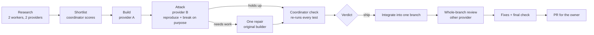
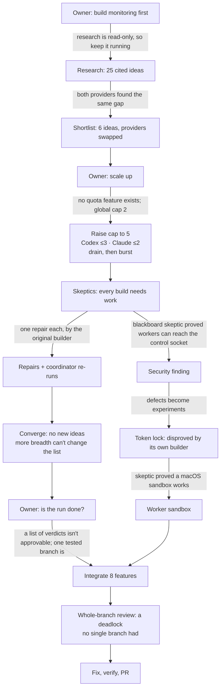
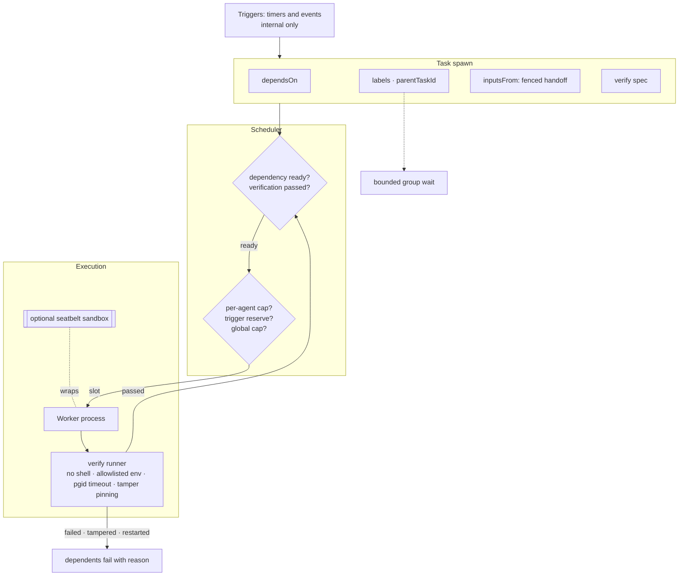
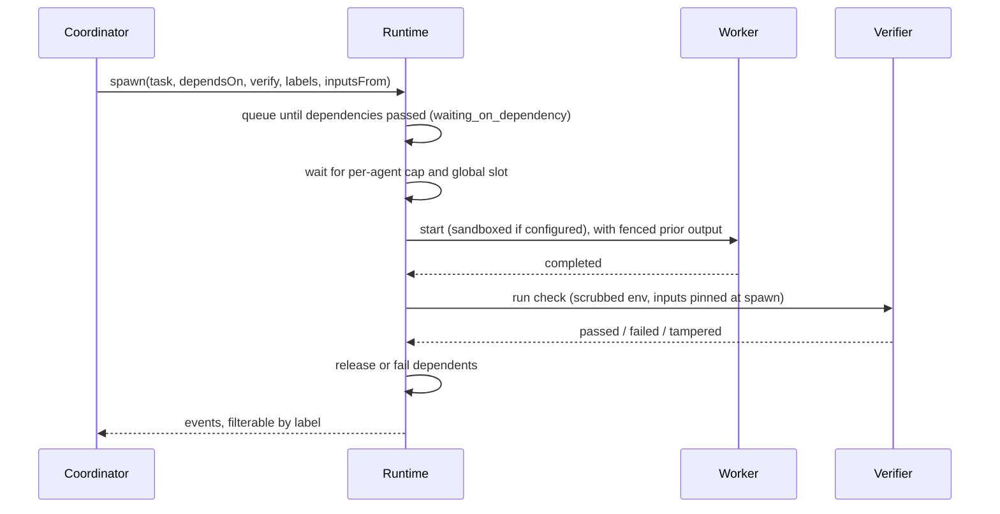

# Agent Bridge Idea Lab: run report

**Date:** 24 October 2026, 21:30–23:15 UTC · **Coordinator:** Claude Code (main session) · **Workers:** Codex and Claude, through Agent Bridge itself
**Delivered as:** PR #11, `feature/agent-control-plane` → `main` (not merged; merging is the owner's decision)
**Companion:** [Feature guide](2026-10-24-feature-guide.md): what each feature adds, usage examples, the workflows it enables, and the defense of each. Every example is checked against the real schemas.

---

## 1. Summary

| Question | Answer |
| --- | --- |
| **What was the goal?** | Find the features that turn Agent Bridge from "hand one task to Codex or Claude" into connective tissue for **software factories, personal assistants and swarms**, and prove each one before it lands. |
| **What came out?** | **8 features** that survived build, attack, repair and re-check, merged into one branch with **211/211 tests passing**. Also **3 security defects** found and fixed, and **1 idea disproved**. |
| **How much work was it?** | 33 worker tasks (Codex 20, Claude 13). **0** failed, **0** timed out, **0** loops. About 105 minutes of wall-clock time. |
| **What do you need to do?** | Review PR #11 using the 15-minute checklist (section 9), then decide whether to merge. The worker sandbox's scope was decided by the owner on 25 October: kept as built (section 7.8). |

---

## 2. How the run worked

The coordinator only planned, dispatched, monitored and judged; it never wrote feature code. Every idea went through a **duel**: one provider built it, the *other* provider attacked it, and the coordinator then checked the outcome itself.

**Why the duel format:** the builder's own "it works" was *never* the full story. All 9 attacked builds came back "needs work" with reproduced evidence, and no skeptic invented a problem. Swapping providers meant neither model was grading its own homework.

**Guardrails held for the whole run:**

- Each task was capped at 10 minutes and given at most one build, one attack and one repair.
- Workers could not start other workers, and each could only write inside its own git worktree.
- Quota policy: at most **3 Codex** and **2 Claude** tasks at once. Claude workers share the coordinator's own account, so they got the tighter limit.
- Live control-plane probes were limited to a single read-only request.

---

## 3. Timeline

```mermaid
gantt
  title Idea lab, 24 Oct 2026 (UTC)
  dateFormat HH:mm
  axisFormat %H:%M
  section Setup
  Control plane and monitoring      :done, 21:32, 7m
  section Research
  Outside world (Codex)             :done, 21:32, 3m
  Our own code (Claude)             :done, 21:32, 2m
  Shortlist (coordinator)           :done, 21:34, 3m
  section Duels: wave 1
  Task dependencies                 :done, 21:38, 11m
  Task groups                       :done, 21:38, 14m
  Verification verdicts             :done, 21:43, 17m
  Fenced handoff                    :done, 21:43, 11m
  Per-agent caps                    :done, 21:43, 14m
  Shared blackboard                 :done, 21:45, 7m
  section Duels: wave 2 and lab-born
  Timer and event triggers          :done, 21:48, 13m
  Socket token lock (disproved)     :done, 21:53, 9m
  Hermetic tests                    :done, 21:53, 3m
  Worker sandbox                    :done, 22:34, 22m
  section Integration
  Merge batch 1 + verified release  :done, 22:34, 5m
  Merge batch 2                     :done, 22:45, 4m
  Merge sandbox                     :done, 22:53, 3m
  Whole-branch review               :done, 22:57, 2m
  Review fixes                      :done, 22:59, 4m
  Final checks and PR               :done, 23:03, 12m
```

The gap from 22:03 to 22:34 was spent on dashboard work and a pause the owner asked for.

---

## 4. The coordinator's decision path

These are the calls that shaped the run, in order, with the reason for each.

| # | Decision | Why |
| --- | --- | --- |
| 1 | Duel ideas, not providers | Measures the *idea*. Neither model grades itself. |
| 2 | Keep research running while monitoring is built | Read-only, short, and no risk. |
| 3 | Stop after one research round | 25 cited ideas, with both providers agreeing on the main gap. |
| 4 | Quota policy: Codex up to 3, Claude up to 2 | Claude workers share the coordinator's account. |
| 5 | Drain, then reconfigure, then burst | Config changes only apply when the runtime is idle. |
| 6 | Repairs go back to the original builder's conversation | It already has the context. One repair maximum. |
| 7 | Turn defects found by workers into experiments | Real defects are worth more than speculative ideas. |
| 8 | Dependents wait for a *passed* check, but only with tamper detection | Otherwise a faked pass would release the next pipeline stage. |
| 9 | Leave a Claude slot idle rather than use it on premature work | Saves the owner's main quota. |
| 10 | Stop opening ideas once every idea had a verdict path | Breadth could no longer change the ranking. |
| 11 | Integrate into one branch with a whole-branch review | Per-feature duels can't catch composition bugs, and one did exist. |
| 12 | Never merge; open a PR | Merge authority stays with the owner. |

---

## 5. Experiments at a glance

| Idea | Builder → Skeptic | What the skeptic found | Fix | Result | Worth it? |
| --- | --- | --- | --- | --- | --- |
| Task dependencies | Codex → Claude | A key liveness fix had no test that could catch its removal | Test added, plus restart test and `queueReason` | **Ship** | Yes: a core primitive for about 10 worker-minutes |
| Task groups | Claude → Codex | A wait over 6,000 tasks took 4.8 s and returned 2.3 MB | Bounded and summarised: 10.5 ms | **Ship** | Yes: caught a performance cliff before shipping |
| Verification verdicts | Codex → Claude | Leaked the coordinator's secrets; a worker could fake a pass | Env scrubbed, process-group kill, tamper detection | **Ship** | Yes: highest value per minute |
| Fenced handoff | Claude → Codex | The fence held, but the tests wouldn't notice if it broke | Regression tests, emoji-safe truncation | **Ship** | Yes |
| Per-agent caps | Codex → Claude | Right idea, wrong settings layer; broke conversations | Moved to preferences, clamps, fingerprint-safe | **Ship** | Yes: encodes the real quota policy |
| Timer and event triggers | Codex → Claude | Paid work with no budget and nobody watching | Fire caps, auto-disable, reserved interactive slot | **Ship, internal only** | Partly: value deferred until the sandbox sees real use |
| Hermetic tests | Codex → coordinator | (found by an earlier builder) | Test helper | **Ship** | Yes: unblocked every worker |
| Worker sandbox | Codex → Claude | A worker could rename the relocated socket and connect | Deny the whole socket folder | **Ship** | Yes: it's the gate for swarms |
| Socket token lock | Codex → Claude | Its own builder broke it: a worker read the token and spawned | (n/a) | **Disproved** | Yes: stopped false security from shipping |
| Shared blackboard | Claude → Codex | No worker can reach it yet; surfaced the socket hole | (n/a) | **Deferred** | Partly: found the biggest security issue |

Parked without experiments: checkpointed step ledger, A2A adapter, MCP Tasks extension, SQLite event store, auto-answering permission policy. They were too large or lower leverage for this run.

---

## 6. What this PR adds and how it fits together

**One task's life, start to finish:**

---

## 7. Each feature in detail

### 7.1 Hermetic tests
**Problem:** every worker inherits `AGENT_BRIDGE_WORKER=1`, and 10 plugin tests failed whenever a worker ran the suite. **Change:** a test helper clears the variable for CLI children; the recursion-guard test still sets it on purpose. **Evidence:** 211/211 with the variable set and unset. A deliberate guard-disable makes the guard test fail.

### 7.2 Verification verdicts
**Problem:** "completed" only meant the worker *said* it was done. **Change:** an optional coordinator-supplied command runs after completion and records `passed`, `failed` or `tampered` separately:
- argv only, no shell
- environment taken from the provider allowlist, with secrets only through explicit opt-in
- the timeout kills the whole process group
- files the check depends on are hashed at spawn, and edits make the result `tampered`

**Evidence:**
- A fake secret did not reach the check.
- A worker rewriting `"test": "exit 0"` produced `failed(tampered)`.
- Deliberately disabling the timeout kill made the test fail in 0.8 s instead of hanging.

### 7.3 Fenced handoff (`inputsFrom`)
**Change:** earlier task output goes into a new prompt inside a random-nonce fence labelled untrusted data. It is bounded, surrogate-safe, and accepted only from sources whose verification passed. **Evidence:** a deliberately predictable-nonce version, which used to pass all tests, now fails 2.

### 7.4 Dependency scheduling (`dependsOn`)
**Change:** tasks wait for their dependencies without holding a slot, and fail fast, naming the dependency, if one fails or is cancelled. It survives restarts and shows `queueReason`. **Evidence:** 4 of 5 deliberate breakages were caught at first; the missed one was fixed and is now caught.

### 7.5 Release only on verified success
**Change:** when a dependency has a verify spec, dependents start only on `passed`. On `failed`, `tampered` or `restarted` they fail with that reason. **Why it needed 7.2 first:** without tamper detection, a faked pass would automatically release the next stage.

### 7.6 Labels, lineage and group wait
**Change:** labels and `parentTaskId` on spawn, label-filtered events, and a group wait capped with a summary. **Evidence:** 5,000 tasks take 10.5 ms and 1.9 KB (previously seconds and megabytes).

### 7.7 Per-agent caps and label budgets
**Change:** `agents.<id>.maxConcurrent`, overridable from workspace preferences, clamped to the global cap with the clamp reported, and excluded from the conversation fingerprint. **Evidence:** the lab's real policy (Codex 3 / Claude 2) ran exactly as intended under a mixed queue.

### 7.8 Worker sandbox (seatbelt)
**Change:** an opt-in `isolation: seatbelt` wraps a full-access provider in macOS `sandbox-exec`, denying the state directory and the runtime socket, including the relocated `/tmp` socket folder.

**Evidence:**
- Reading or writing the state directory and connecting to the socket all return EPERM.
- Symlinks, `/tmp`↔`/private/tmp` aliasing, hard links and child processes are all blocked.
- Renaming the socket or its folder is blocked, and deliberately removing the fix lets the rename attack connect again.

> **Owner decision, 25 October: the scope stays as built.** It is opt-in, **macOS only**, **full-access profiles only**, and refused where a provider runs its own sandbox, because sandboxes can't nest. Real Codex and Claude logins should keep working, but that was traced in code, not run.

### 7.9 Timer and event triggers (internal only)
**Change:** a persisted registry turns timers and events into tasks, with dedupe, skip-overlap, bounded catch-up, per-trigger and global fire caps, auto-disable after 3 failures, and a reserved interactive slot. **Deliberately not exposed as tools** until the sandbox is in real use, because unattended paid work combined with workers that can reach the socket is how runs go out of control.

---

## 8. Security findings

| Finding | How it was found | Status |
| --- | --- | --- |
| Workers can reach the coordinator's control socket. The "no recursion" guard is only an environment variable. | A blackboard skeptic made one read-only request from a worker and got HTTP 200 with diagnostics | **Mitigated** for full-access workers by the opt-in sandbox (7.8). A token alone was disproved. |
| The verify command leaked the coordinator's secrets to worker-editable code | Verify skeptic, with a fake token | **Fixed** (7.2) |
| Sandbox bypass via renaming the relocated socket | Sandbox skeptic | **Fixed** (7.8) |
| 10 tests broken inside workers | First builder | **Fixed** (7.1) |

---

## 9. Integration, review and validation

**How the merge went:** the features were merged in three batches. The ones that touch the scheduler went last and were hand-merged, keeping every behaviour, plus one cross-feature test that covers them all at once.

**Whole-branch review (other provider): approve with fixes.**

| Finding | Severity | Fixed by |
| --- | --- | --- |
| A restart *during* verification left dependents waiting forever. This existed only after merging. | High | Recovery marks it `failed (restarted)`. The test fails without the fix. |
| Handoff could pass on output that had failed verification | Medium | Handoff requires a passed source |
| Idempotent retry resolved inputs too early | Low | Reordered |
| A guard checked in the wrong process | Low | Documented as defense in depth; the real guard holds |
| `lab-*` names left in source | Low | Renamed |

**Final validation (coordinator):** 211/211 in both modes. The final tree is byte-identical to the tested branch; this PR's history was rebuilt only to drop lab bookkeeping commits.

**Known issue:** one rare flaky test (1 failure in 14 full runs, worker mode, unidentified). It's most likely the stderr-burst or delayed-verifier reload test. Worth a follow-up to make them deterministic.

### 15-minute reviewer checklist

1. `git diff --stat main...feature/agent-control-plane`. Only `src/`, `test/`, `scripts/mock-acp.mjs` and `INTEGRATION_NOTES.md` should change.
2. Read `schedule()` in `src/runtime.ts`: the failure sweep comes first, then the trigger reserve, then per-agent caps.
3. Read restart recovery in `src/runtime.ts` (~line 257): completed tasks with pending verification should fail as `restarted`.
4. Read the handoff source check: it should use `dependencyReady` and run after the taskKey short-circuit.
5. Run `grep -n AGENT_BRIDGE_WORKER src/mcp.ts`. Worker mode should register no tools.
6. Run `npm test` and `AGENT_BRIDGE_WORKER=1 npm test`.

---

## 10. Problems during the run and how they were handled

| Problem | Handling |
| --- | --- |
| Only 2 tasks could run at once, and there is no quota feature | The owner authorised scaling; the cap went to 5 with per-provider limits enforced by the coordinator (now a real feature, 7.7) |
| Completion notices arrived 3–15 minutes late, and once a stale "reply needed" | A git-commit watcher was used as the real-time signal, and status is always checked before replying |
| A symlinked `node_modules` could have been committed | Excluded locally before fan-out |
| A skeptic wrote probe scripts to `/tmp`, outside its worktree | Harmless, but it broke the write-scope rule. Future roles need a sanctioned scratch path. |
| Feature branches cut from the lab HQ pulled journal commits into the integration history | This PR's history was rebuilt with an identical final tree |
| The first dashboard was unreadable for humans, and a rewrite replaced a layout the owner liked | Restored, then improved in place: live/scrub, idea × stage grid, and a click-through reasoning chain |

---

## 11. Lessons for making this repeatable

1. **Two views from day one:** a machine control plane, and a human view (story, path, drill-down).
2. **Pre-flight the environment once** before fanning out. Two traps here would otherwise have cost every worker time.
3. **A committed contract per experiment**, including "a disproved idea is a valid result". One builder honestly disproved its own idea because of it.
4. **The skeptic is mandatory, and must break the code on purpose.** Every build needed work.
5. **An integration-level skeptic is mandatory too.** The worst bug only existed after merging.
6. **Repairs get a coordinator re-run, not a second review.** That's cheap, and it's what found the flake.
7. **Repeat the final suite several times** and record the flake rate. A single green run isn't proof.
8. **Never let control-plane work pause the experiment.**
9. **Cut feature branches from `main`**, with lab notes kept only in the HQ, so integration history stays clean.
10. **Deliver as a feature branch plus PR plus committed report. Never merge.**

---

## Appendix A: Glossary

| Term | Meaning |
| --- | --- |
| Coordinator ("queen") | The main Claude Code session: it plans, dispatches, monitors and judges |
| Builder / skeptic | The worker that implements an idea, and the worker from the other provider that attacks it |
| Repair | The single allowed fix round after a skeptic's "needs work" |
| Coordinator check | The coordinator re-running the full test suite itself |
| Approval gate 1 | Owner decision on the worker sandbox's scope (section 7.8): decided 25 October, kept as built |
| Approval gate 2 | Owner decision to merge this PR |
| Worktree | A separate git checkout per experiment, so workers never collide |

## Appendix B: Where everything is

| What | Where |
| --- | --- |
| Lab HQ (charter, ledger, journal, verdicts, research) | `../agent-bridge-lab/hq/lab/` (branch `lab/hq`) |
| Per-experiment specs, evidence and skeptic reports | `../agent-bridge-lab/<idea>/lab/` (branches `lab/<idea>`) |
| Tested integration branch (full history) | `lab/integration` |
| Whole-branch review | `../agent-bridge-lab/hq/lab/verdicts/INTEGRATION_REVIEW.md` |
| Reusable worker roles | `.specialists/lab/{researcher,spike-builder,skeptic}` |
| Live dashboard | https://claude.ai/artifact/3So4wufz5ynpJ5GN42uwqu (private) |
