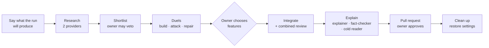

# Idea lab skill: making the next lab readable and owner-led

**Date:** 25 October 2026 · **Branch:** `feature/idea-lab-skill` · **Builds on:** the lab run of 24 October that produced PR #11

## In plain words

The first idea lab built strong, well-tested features, but the owner couldn't follow it. They didn't get to choose which features were kept, and the final guide was written for code reviewers. This change turns that run into a repeatable skill (`/agent-bridge:idea-lab`) with rules that put the owner in control:
- The owner is told up front what they will get.
- The owner chooses which proven features go in.
- Every document they read is tested on a first-time reader before it ships.

It adds no runtime code.

## What went wrong last time, and the rule that answers it

| What happened on 24 October | Rule now in the skill or the worker roles |
| --- | --- |
| About 12 of the owner's 16 messages were some form of "I can't see what's going on" | Before the first dispatch, one message says what the run will produce and when the owner will be needed |
| The lab was called finished while it was still seven loose branches; integration happened only because the owner asked | "Done means approvable": one change, a guide, a checklist and test commands |
| All eight features went into one PR without the owner choosing any | A menu step: the owner picks the proven features, and only those are integrated |
| A "plain language" rule saved in the coordinator's memory never reached the worker writing the guide | Every worker role now carries the house rules itself, because workers can't see the coordinator's memory |
| The fact-check made the guide more exact and harder to read, and appended a 20-item correction log | The explainer leads with "what you can do now". The fact-checker keeps fixes short and puts detail in an appendix. A **cold reader** who never sees the code must be able to explain each feature |
| Gate codes ("G1", "G2") meant nothing to the owner | Names, not codes, in anything the owner sees |
| The coordinator chose a merge option it had offered the owner, and shipped past an unanswered question | "Never resolve a decision you put to them" |
| A layout the owner liked was replaced; a page delete was attempted without asking | One status page, improved in place; ask before anything destructive or outside the repo |
| A skeptic wrote probe scripts to `/tmp`, outside its allowed area | Scratch files go only in `tmp/` inside the worktree, and are deleted |
| Late completion notices caused stale replies | Check the task's current status before acting on any notice |
| Lab bookkeeping leaked into the integration history | The integrator cuts from the target branch and keeps lab files out of history |
| A test that fails intermittently showed up only on the coordinator's 14th run | The integrator runs the suite at least three times per mode and names any test that failed |

## How the run now flows

The owner is needed twice: at the diamond (which features) and at the pull request (approve). Everything else proceeds and is reported in three-line updates.

## What changed

| File | What it is |
| --- | --- |
| `skills/idea-lab/SKILL.md` | The coordinator's playbook: the up-front message, ten phases, control rules, and how to talk to the owner |
| `.specialists/lab/researcher`, `spike-builder`, `skeptic` (now version 1.1.0) | The three roles from the first run, now carrying house rules. Builders must not edit tests to make them pass. Skeptics must break the code on purpose. Both start their reports "In plain words" |
| `.specialists/lab/integrator`, `integration-reviewer` | New. The integrator combines only the chosen features with a clean history. The reviewer from the other provider hunts bugs that appear only in combination |
| `.specialists/lab/explainer`, `fact-checker`, `cold-reader` | New. Writing, checking, and testing that a first-time reader can follow the owner's guide |
| `test/idea-lab.test.mjs` | Pins the skill's key rules and checks that every role is valid and carries the house rules, following the existing `specialize` skill test |

## How it was checked

- `npm test` passes 142 of 142: the existing 139, plus 3 new.
- The new tests were broken on purpose three ways: house rules removed from a role, a role ID mismatched to its folder, and the "never resolve a decision" rule weakened. Each time the matching test failed. The files were then restored.
- Each role parses with Agent Bridge's real specialist loader. Two were also run through `specialists_validate` against the configured `codex-worker` and `claude-worker` profiles, and both bind.

## What this does not do

- **These are instructions, not enforcement.** The validator states that a specialist adds "no extra tool enforcement". A worker that ignores its brief can still write outside its folder, and a coordinator can still resolve a decision it should have left to the owner. Enforcing the most important rules (owner-only decisions, write scope) needs runtime support, which is a separate proposal.
- **The cold-reader step costs one or two extra tasks per run.** That is a deliberate trade for a guide the owner can use.
- **The skill hasn't been run end to end.** Its first real test is the next lab.

## How to review (about 10 minutes)

1. Read `skills/idea-lab/SKILL.md` and ask whether this is how you want a lab to treat you.
2. Skim one new role, such as `.specialists/lab/cold-reader/specialist.yaml`, for tone and scope.
3. Run `npm test`; it should pass 142 of 142.
