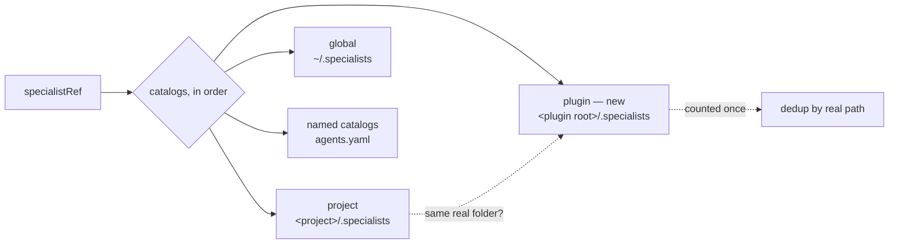

# Plugin catalog root: PR report

## In plain words

Specialists saved inside the Agent Bridge plugin's own `.specialists/` folder now show up in every project you open, under a new catalog called `plugin`. The idea lab's roles, and roles from future apps built on Agent Bridge, can now be shipped with the plugin instead of being copied into each project. Inside the Agent Bridge checkout, where the project and the plugin are the same folder, nothing becomes ambiguous.

## What changed

| File | Change |
| --- | --- |
| `src/specialists.ts` | New `plugin` catalog at `<plugin root>/.specialists`. The plugin root comes from the module's own location (`dist/..`), the same way `effective-config.ts` finds the bundled `agents.yaml`. A new `distinctCatalogs` helper skips any catalog whose real folder an earlier catalog already covers. Both unqualified resolution and the listing use it. |
| `src/config.ts` | `plugin` is reserved alongside `project`, `global` and `inline`. `Config` gains an optional `pluginRoot` override. It is not read from `agents.yaml`, and tests use it to point the plugin catalog at a fixture folder. |
| `src/runtime.ts` | `specialists_schema` describes the plugin location and lists `plugin` among the reserved names. `availableCatalogs` shows the plugin catalog's real path. |
| `test/specialists.test.mjs` | Two new tests; the reserved-name loop now includes `plugin`. |
| `docs/SPECIALIZED_AGENTS.md`, `README.md` | One or two sentences each. |

**How the plugin root is found.** It comes from `new URL("../", import.meta.url)` and not from `CLAUDE_PLUGIN_ROOT`, for three reasons:
- `src/` never reads that variable. Only `.mcp.json` uses it, to start `dist/cli.js`, so the module location is the same folder by construction.
- Node resolves symlinks in ESM module URLs, so the path is a real path. The catalog safety check (`checkDirectories`) rejects symlinked ancestors, so a symlinked environment-variable path would have made the whole catalog unavailable.
- It works the same when the runtime is started outside Claude Code (tests, the CLI).

## How it was tested

`npm test` (build plus the full suite), run in this worktree: **213 tests, 213 pass, 0 fail**. The baseline was 211; the 2 new tests account for the difference.

New coverage:
- **Plugin-catalog resolution.** By default the plugin catalog is the install root's `.specialists`. With the root pointed at a fixture install, `lab/queen` resolves from an unrelated project as `plugin:lab/queen`. `specialists_catalog` lists it with `catalog: "plugin"` and no instructions. `specialists_schema` reports it and reserves the name.
- **Ambiguity.** The same `lab/queen` in the plugin catalog and a `team` catalog fails with "use plugin:lab/queen or team:lab/queen". Both qualified forms resolve to the right content.
- **Same-folder deduplication.** With the plugin root equal to the project root, `lab/queen` resolves without ambiguity as `project:lab/queen`, and the listing shows it once. `plugin:lab/queen` still resolves when asked for explicitly. A symlinked path to the same folder also counts as one catalog.
- **Reserved name.** `specialistCatalogs: { plugin: … }` is rejected by the schema.

## Choices I made

- **Inside the checkout, the shared folder is reported as `project`, not `plugin`.** `project` comes first in catalog order, and existing references and tests already use that name. `plugin:…` references still work there, so docs written for other projects keep working in the checkout.
- **Deduplication applies to every catalog, not just project and plugin.** A named catalog in `agents.yaml` that points at the same folder as another catalog no longer produces a spurious ambiguity between two references to the same file. Before, this raised an error; now it resolves to the earlier name. No existing test relied on the old error.
- **Catalog order is project, global, plugin, then named catalogs.** Order only matters for deduplication and for listing order. Resolution of unqualified references still requires a unique match.
- **The test override is an optional `Config.pluginRoot` field,** not an environment variable. That way users and workers get no new runtime setting that could redirect the catalog.

## Risks and what is left

- Specialists in the plugin catalog sit in the plugin's install folder. A plugin update replaces them, so that folder is meant for roles the plugin ships, not user edits. The docs say "shipped with the plugin"; the `specialize` skill does not yet steer saves away from it.
- If a user's project or global catalog has the same `namespace/id` as a plugin role, unqualified references become ambiguous and the user must qualify them. This follows the existing rule and is deliberate, but it means adding plugin roles can make previously unique names ambiguous for some users.
- The repository has no `.specialists/` folder yet. The lab roles arrive with PR #12; after both merge, they appear in other projects as `plugin:lab/<id>`.
