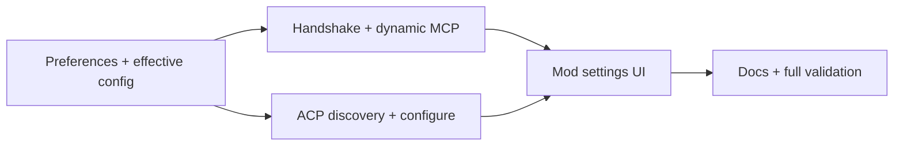

# Harness-Neutral Worker Settings and Updates — Implementation Plan

## Context

Implements [PRODUCT.md](PRODUCT.md) against `agent-bridge` commit `9537d03cf8f02c8bf3e1e24298ff1b27c0b807a9`.

Current plugin configuration is selected and snapshotted in [`src/plugin.ts`](https://github.com/dev-eloper1/agent-bridge/blob/9537d03cf8f02c8bf3e1e24298ff1b27c0b807a9/src/plugin.ts): `agents.bridge.yaml` wins, otherwise `.agent-bridge/plugin-agents.yaml` is created once from bundled defaults. `ensureRuntime` checks only reachability. This makes generated provider definitions stale after updates and requires explicit daemon restarts.

[`src/acp.ts`](https://github.com/dev-eloper1/agent-bridge/blob/9537d03cf8f02c8bf3e1e24298ff1b27c0b807a9/src/acp.ts) already applies arbitrary modern ACP config options and legacy modes after session setup. It does not expose a probe-only normalized option catalog. [`src/runtime.ts`](https://github.com/dev-eloper1/agent-bridge/blob/9537d03cf8f02c8bf3e1e24298ff1b27c0b807a9/src/runtime.ts) exposes requested/effective session config and sanitized doctor output but no build/config handshake. [`hooks/register.js`](https://github.com/dev-eloper1/agent-bridge/blob/9537d03cf8f02c8bf3e1e24298ff1b27c0b807a9/hooks/register.js) owns the direct human `/workers` pane and is the correct non-model settings surface.

The implementation must preserve specialist snapshots and exact unprefixed `specialists_*` tools introduced before this feature.

## Proposed changes

### 1. User-owned workspace preferences

Add `src/preferences.ts` with:

```ts
type SessionConfigValue = string | boolean;

interface WorkspacePreferences {
  version: 1;
  workspaceIdentity: {
    canonicalPath: string;
    device: string;
    inode: string;
  };
  useManagedDefaults: boolean;
  agents: Record<string, { sessionConfig: Record<string, SessionConfigValue> }>;
  runtime?: Partial<{
    maxConcurrentTasks: number;
    maxRuntimeMs: number;
    maxInlineChars: number;
    maxArtifactBytes: number;
  }>;
  legacy?: {
    importedFrom: string;
    warnings: string[];
  };
}
```

- Root: `${XDG_CONFIG_HOME ?? ~/.config}/agent-bridge/workspaces/`.
- Filename: SHA-256 of canonical path plus filesystem device/inode.
- Directories mode `0700`, files mode `0600`, atomic temp-write/fsync/rename.
- Strict bounded schema, no symlinked ancestors/leaf, original preserved on parse failure.
- Workspace identity uses the existing canonical identity rules from `src/workspaces.ts`.
- Exports `preferencePath`, `loadPreferences`, `savePreferences`, `updatePreference`, and safe metadata helpers.

### 2. Effective config compilation

Add `src/effective-config.ts` and refactor `pluginConfig`:

```ts
interface PluginConfigContext {
  file: string;
  config: Config;
  workspace: string;
  preferencesFile?: string;
  sources: {
    bundled: string;
    project?: string;
    explicitEnvironment?: string;
    legacyGenerated?: string;
  };
  migrationWarnings: string[];
}

function compilePluginConfig(
  cwd?: string,
  options?: { bundledFile?: string },
): PluginConfigContext;
```

- `AGENT_BRIDGE_CONFIG` remains an explicit trusted base and retains its session config.
- Otherwise current bundled `agents.yaml`, transformed by `projectConfig`, is the managed base.
- An advanced project `agents.bridge.yaml` is the base unless preferences record `useManagedDefaults: true`.
- Project session config is removed from the runtime base unless confirmed by matching user preferences. Requested project values remain metadata for settings UI.
- User preferences overlay per-agent session config and optional runtime limits. Unknown saved profile IDs remain metadata but do not enter `agents`.
- The effective file is `.agent-bridge/effective-agents.yaml`, written atomically only when bytes change. `loadConfig` validates it and computes `configDigest` from normalized loaded configuration.
- New installations never create `plugin-agents.yaml`.

Legacy `.agent-bridge/plugin-agents.yaml` handling:

- Compare provider/profile/runtime fields against current prepared bundled defaults.
- Import runtime limits and existing agent session config when safe.
- Provider-level differences create warnings and keep the legacy file as the base until direct migration.
- Never copy credentials, inherited values, or provider env into preferences.
- Never delete/modify the legacy file.

### 3. Build/config daemon handshake

Add `src/build-id.ts`:

- Compute once at process startup.
- Hash package version plus the compiled runtime/plugin/config/ACP/server/preferences modules.
- A running daemon retains its startup value even if files are rebuilt in place.

Extend `Config` with `configDigest`. Extend runtime doctor with:

```ts
daemon: {
  pid: number;
  buildId: string;
  configDigest: string;
  startedAt: string;
}
```

Refactor `ensureRuntime` to return:

```ts
type RuntimeReadiness =
  | { status: "ready"; restarted: boolean }
  | {
      status: "update_pending";
      activeTaskIds: string[];
      liveBuildId?: string;
      desiredBuildId: string;
      liveConfigDigest?: string;
      desiredConfigDigest: string;
    };
```

- Compare live doctor build/config values with desired values.
- Old daemons without doctor are stale.
- If stale and idle, shutdown, wait for lock/socket removal, and launch current code automatically.
- If stale with nonterminal tasks, do not restart.
- `mcp` passes the method name to a dynamic pre-call resolver that returns the freshly compiled `Config`; each call dispatches against that config's socket so a changed effective config (for example a different stateDir) reaches the new daemon. Read/supervision methods (`list`, `status`, `wait`, `result`, `artifact`, `events`, `reply`, `cancel`, `doctor`) continue against stale active daemons. New dispatch or config-mutating operations receive an update-pending error.
- Recompute `pluginConfig` before every MCP call so direct settings changes cannot be reverted by a long-lived MCP facade.

### 4. Harness-neutral ACP option discovery

Add normalized types/helpers in `src/session-settings.ts` and bounded probes in `src/worker-settings.ts`:

```ts
interface SessionSettingChoice {
  value: string;
  name: string;
  description?: string;
}

interface SessionSettingOption {
  id: string;
  name: string;
  description?: string;
  category?: string;
  type: "select" | "boolean";
  currentValue: string | boolean;
  choices?: SessionSettingChoice[];
  source: "config_option" | "legacy_mode";
}
```

- Normalize v1 `id`, v2-style `configId`, grouped selects, booleans, and legacy modes.
- Preserve provider order and descriptions; bound all strings/counts.
- Export `normalizeSessionSettings` and `validateSessionSetting`, shared by probe/configure and `Worker.applySessionConfig`.

`src/worker-settings.ts` exports `AgentSettingsProbe`, `probeAgentSettings(config, agentId)`, and `probeAllAgentSettings(config)`, which:

- Resolve profile availability using existing executable logic; unknown agent IDs fail with a bounded error.
- Start ACP, initialize, create a new session with no model prompt, normalize options, and always kill the process.
- Return one bounded result/error per profile.
- Probe profiles concurrently with a fixed bound of two, preserving config order.

### 5. Human settings operations

Add plugin functions and CLI commands:

- `plugin-settings [JSON]` (implemented as `pluginSettings(cwd, {agentId?})`): read-only; accepts optional `agentId`; returns workspace, preference path (even before the file exists), config provenance, warnings, project-requested session config, readiness, and normalized probe results. Daemon startup failure still returns probes/provenance with `readiness: {status:"error", error}`.
- `plugin-configure JSON` (implemented as `pluginConfigure(cwd, input)`): `{agentId, configId, value}`; re-probes, validates exact option/value/type, atomically saves preference, recompiles config, and restarts idle daemon or reports `update_pending`.
- `plugin-configure JSON` clear form: `{agentId, configId, clear:true}`; removes exactly one key without requiring the provider.
- `plugin-migrate-managed` (implemented as `pluginMigrateManaged(cwd)`): direct choice to set `useManagedDefaults:true`; preserves saved agent/runtime/legacy preferences and leaves project/legacy files untouched.
- New preferences created under a managed base record `useManagedDefaults:true`; under an advanced/legacy base they record `false` so configuration never implicitly switches bases.
- Existing `plugin-doctor` includes provenance and readiness.

These commands are CLI/Mod operations and are not registered as MCP tools.

### 6. `/workers settings` Mod screen

Extend Mod state with `screen: "settings"` and transient settings data that is not persisted into Claude session history.

- `/workers settings` runs `plugin-settings` through `$.process.run`, opens the existing pane, and renders profile cards.
- Available normalized options render as native `Select` controls. Booleans render as provider-neutral Enabled/Disabled choices while retaining boolean values.
- `onSelect` invokes `plugin-configure`, refreshes settings, and displays applied/pending/error state.
- Unavailable/no-options/error profiles remain visible.
- Advanced/legacy source warnings render with a direct “Use managed plugin defaults” button invoking `plugin-migrate-managed`.
- Existing overview/detail/history navigation remains unchanged.
- Noninteractive/no-Select hosts receive exact CLI fallback text.

Direct UI callbacks are human events. No MCP tool gains setting-write capability.

### 7. Docs and migration guidance

Update README, `docs/CLAUDE_PLUGIN.md`, `docs/USAGE.md`, `docs/WORKER_SETTINGS.md`, help text, and roadmap:

- Normal setup: install, `/workers settings`, choose profile values once.
- Normal update: update/build, `/reload-plugins`; idle runtimes update automatically.
- Active-task pending behavior.
- Managed vs. advanced project configuration.
- User preference storage and security boundary.
- Harnesses without editable ACP settings.
- One-time legacy migration.
- Remove instructions that tell ordinary users to edit generated config.

Keep `agents.bridge.yaml` documented as an advanced full-base override.

## End-to-end flow

```mermaid
flowchart TD
  Plugin[Current plugin defaults] --> Compile[Compile effective config]
  Project[Optional advanced project base] --> Compile
  Prefs[User workspace preferences] --> Compile
  Compile --> Effective[Private effective-agents.yaml]
  Effective --> Ensure[Ensure runtime]
  Ensure -->|matching| Daemon[Current daemon]
  Ensure -->|stale + idle| Restart[Automatic restart]
  Ensure -->|stale + active| Pending[Update pending; supervise only]
  Settings[/workers settings] --> Probe[Probe ACP without prompt]
  Probe --> Select[Human selects provider value]
  Select --> Prefs
```

## Testing and validation

- `test/preferences.test.mjs`: PRODUCT 10–12, 16, 32; identity isolation, permissions, atomic persistence, invalid/symlinked state.
- `test/effective-config.test.mjs`: PRODUCT 12–20; managed overlays, advanced bases, current defaults after update, legacy import/warnings, no secret migration.
- `test/session-settings.test.mjs`: PRODUCT 2–9, 17; modern/legacy/group/boolean/no-options/unavailable/auth failures and exact validation.
- `test/plugin.test.mjs` and `test/reliability.test.mjs`: PRODUCT 20–28; build/config handshake, idle auto-restart, active deferral, dynamic config refresh, conversation/history preservation.
- `hooks/bridge.test.ts`: PRODUCT 1–9, 18, 25, 27; settings screen, selects, failures, migration, pending state, existing navigation unchanged.
- Existing specialist/runtime suites: PRODUCT 29–31.
- Full gates:

```sh
npm test
npm run test:mod
npm run demo
git diff --check
```

- Live provider probe remains optional and must not be required for deterministic CI. Mock ACP fixtures cover advertised settings.

## Parallelization

Implementation uses one isolated integration worktree and the session’s persistent implementation sidekick because the available runtime exposes one shared sidekick rather than an independent worker fleet. Work proceeds in dependency order:



- Integration branch: `scratch/devin/harness-neutral-worker-settings`.
- Worktree: `/Users/bhus.karayilthekkoot/Documents/projects/agent-bridge-worker-settings-worktree`.
- One combined PR; no task branch may commit or push independently.

## Risks and mitigations

| Risk                                                   | Mitigation                                                                                        |
| ------------------------------------------------------ | ------------------------------------------------------------------------------------------------- |
| Repository silently enables a permissive provider mode | Strip project session config from normal effective config until a matching user preference exists |
| Provider option semantics differ                       | Show and store exact provider metadata; no universal mode aliases                                 |
| Update interrupts work                                 | Defer restart and allow supervision/cancellation only                                             |
| Long-lived MCP uses stale config                       | Recompile/reload before every call and compare daemon handshake                                   |
| Generated snapshot freezes bundled fixes               | Managed effective config is regenerated from current defaults                                     |
| Legacy custom provider settings are lost               | Detect differences, retain legacy base, require direct managed migration                          |
| Preference path reused by another checkout             | Key and validate canonical path plus device/inode                                                 |
| Probe consumes model quota or edits files              | Session setup only; never call `session/prompt`; always terminate process                         |
| Settings regress specialists                           | Preserve specialist schemas/snapshots and run all existing tests                                  |
