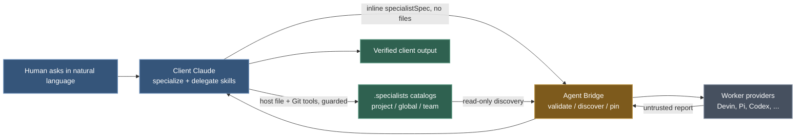
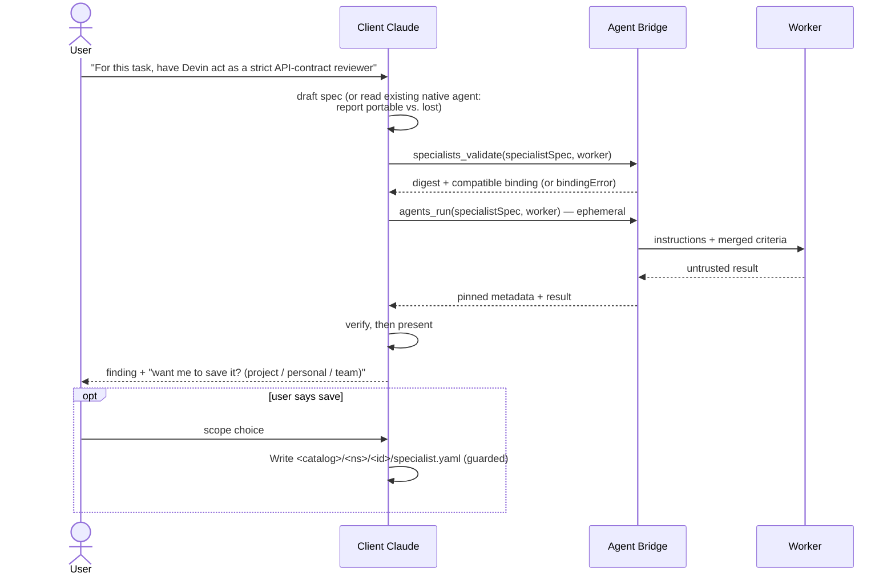

# Specialized Workers: Ecosystem and Ownership

**Executive summary.** Agent Bridge is a generic execution runtime: it validates, discovers, pins and runs declarative **specializations**, and never writes them. A specialized worker is a worker profile (Devin, Pi, Codex…) plus a specialization plus an assignment. Authoring and management are not a separate registry or plugin — they are the `specialize` skill installed with the Agent Bridge Claude plugin, which lets Claude create, adapt, save, update, delete, promote and organize specialists using its ordinary file and Git tools under the host client's guards and approvals. A `.specialists` catalog is a plain folder used only when a specialist should persist, be reused or be shared; a one-off specialist runs inline and ephemerally with no files at all. This document explains who owns what, how a specialist travels from a sentence to a verified result, and what changes next. It supersedes the earlier registry-plugin and Agent Repo designs.

## Design principles

- **Agent Bridge stays generic.** It owns the specialization schema, read-only catalog/discovery, deterministic validation, compatibility checks, immutable snapshots/pinning, provider binding and the task/session/artifact lifecycle. It never writes, edits, deletes, copies, versions, commits, pushes, clones or publishes specialist files or catalogs.
- **Management is a skill, not infrastructure.** Creating and curating specialists is Claude using Read/Write/Edit/Glob/Grep/Git under the client's own permissions — no mandatory management plugin. A future optional UI could enhance the same file contract but is not core.
- **Specializations are data owned by clients.** A spec says what a specialist does, its output contract and its compatibility requirements. It cannot install tools, grant permissions, hold secrets or run hooks.
- **Worker profiles supply capability.** Provider, model, native tools, permissions, environment and authentication come from the configured worker — never the spec.
- **Ephemeral first.** Most specialization should not create files. Persistence happens on a natural cue or an offered save.
- **Natural language is the UX.** Users never invoke skill names or know refs, IDs or commands in normal use.

## System at a glance

| Component | Owner | Owns | Never owns |
|---|---|---|---|
| Agent Bridge | This repo | Spec schema, catalog/discovery, validation, compatibility, pinning, execution lifecycle | Writing or publishing specialist files |
| `specialize` / `delegate` / `status` skills | This repo (Claude plugin) | Natural-language authoring and delegation UX | Runtime behavior; they call the bridge |
| `.specialists` catalogs | Users, teams, orgs, client projects | The `specialist.yaml` files, Git history, review | Execution or worker settings |
| `agents.yaml` / `agents.bridge.yaml` | Each project/user | Worker profiles, provider commands, optional `specialistCatalogs:` roots | Spec content |
| Worker providers | Installed CLIs (Devin, Pi, …) | Model, tools, permissions, authentication | Spec semantics |

## The shape of the system



*Legend: steel blue = human and client, ochre = bridge, sage = durable state and verified result, slate = external providers. There is no registry or management-plugin node — management is Claude's own tools.*

## Why have `.specialists` catalogs at all?

A catalog is **only** for persistence, sharing, versioning and stable references. It exists so a proven specialist can be reused next week, reviewed in Git, promoted to a team and referenced unambiguously. It buys nothing else: validation, compatibility, pinning and execution all work identically on an inline ephemeral spec. If a specialist is a one-off, no catalog is needed — and none should be created.

## What lives where

| Scope | Path | Owned by | Use |
|---|---|---|---|
| Ephemeral | nowhere — inline `specialistSpec` in the run call | the conversation | one-off specialization |
| Project | `<project>/.specialists/<ns>/<id>/specialist.yaml` | the project repo, tracked in Git | specialists that belong with the codebase |
| Global/personal | `~/.specialists/<ns>/<id>/specialist.yaml` | the individual user | specialists wanted everywhere |
| Team/org | configured `specialistCatalogs: { team: { path: … } }` | team/org Git repo | shared, reviewed specialists |

`catalog.yaml` inside a catalog root is optional descriptive metadata; discovery never depends on it. Reserved catalog names — `project`, `global`, `inline` — cannot be configured.

Current persisted example (pilot): Hivemind keeps `hivemind/.specialists/hivemind/triage-investigator/specialist.yaml` in its own repo.

## Specialization vs. worker profile

| | Specialization (`specialist.yaml` or inline) | Worker profile (`agents.yaml`) |
|---|---|---|
| Answers | **What to do**: instructions, delivery, output contract, acceptance criteria | **How to run**: provider command, model, native tools, permissions, environment, auth |
| Compatibility | May restrict providers, require enforced read-only | Declares `readOnlyEnforced`; incompatible binding fails before launch |
| Never contains | Commands, env, credentials, executable tools, hooks, MCP servers, approvals, model/reasoning settings | — |
| Lifetime | Resolved and pinned per conversation by digest | Configured once; fingerprinted for conversation safety |

Task = one assignment; conversation = pinned effective specialist + durable worker session.

## Creating a specialist (or an ecosystem)



*"Create an ecosystem" means authoring a coherent collection of independent specialists in one catalog — the client still orchestrates; Agent Bridge is not a workflow engine.*

## Updating and deleting persisted specialists

```mermaid
sequenceDiagram
    actor U as User
    participant C as Client Claude
    participant R as .specialists catalog (Git)
    participant B as Agent Bridge
    U->>C: "Tighten the triage investigator's evidence rules"
    C->>R: resolve + Read specialist.yaml
    C->>C: Edit (host tools, under approvals)
    C->>B: specialists_validate(updated spec)
    B-->>C: new digest, binding OK
    C-->>U: behavioral diff; old conversations keep pinned spec
    U->>C: "Delete the old draft reviewer"
    C->>R: exact resolve → show impact
    C-->>U: confirm?
    U->>C: yes
    C->>R: delete directory (host tools)
    U->>C: "Remove the whole triage ecosystem"
    C->>R: enumerate every specialist + catalog path/scope
    C-->>U: list impact; distinguish contents deletion vs. unregistering a configured catalog; confirm once?
    U->>C: yes
    C->>R: delete catalog contents via host tools / Git rules
    Note over C,R: pinned conversations unaffected; Agent Bridge never writes.
```

*Promoting a specialist to a team catalog is the same shape — a Git branch, copy and PR with review — owned by the client or user. Removing a whole ecosystem works like the delete path at larger scope: every affected specialist and the exact catalog path are enumerated, deleting catalog contents is distinguished from unregistering a configured `specialistCatalogs` entry, one explicit confirmation covers the whole operation, and an ambiguous request never deletes a project, global or team catalog.*

## Who creates and owns specialists?

| Author | Where | Review/publish | Example |
|---|---|---|---|
| Individual | inline or `~/.specialists` | themselves | a personal strict reviewer |
| Project | `<project>/.specialists` | project's normal Git review | repo-specific specialist |
| Team/org | configured catalog | PR + approval | `hivemind/triage-investigator` promoted to the Channels team catalog |

## Natural-language UX

| User says | Result |
|---|---|
| "Ask Devin to review this repo" | Plain delegation; no catalog, no spec |
| "Have Devin use Hivemind's triage investigator" | Catalog → compatible `specialistRef` → pinned run |
| "…for this task / don't save" | Ephemeral inline spec, validated, run |
| "Create a specialized worker that audits Terraform" | Ephemeral first; save offered after a useful result |
| "Save it for this project / for me everywhere / to the team catalog" | Written to that scope via host tools |
| "Update / delete the reviewer" | Edit+validate+diff, or confirm-then-delete — host tools again |
| Failure at any step | Reported with options; never silent fallback |

## Security and trust boundaries

- Specializations are declarative: strict schema, unknown fields rejected, no commands/env/credentials/tools/hooks/MCP/approvals/model settings.
- Persisted specs are read fail-closed: regular files only, no symlinked ancestors or symlinked spec file, bounded size, strict YAML, `namespace`/`id` must match path.
- Spec text is untrusted input to the worker: it may restrict but never grant; a required restriction without provider enforcement fails before launch.
- No connector inheritance: Hivemind hands only named local files/evidence and never injects its BT1, Now Support, M365 or Splunk connectors; the worker's own capabilities stay governed by its profile.
- Pinned digest: edits, deletes or a differing ref/spec cannot change a running conversation.
- Pilot honesty: `requiresReadOnly: false` means instruction-scoped, coordinator-verified — not a provider-enforced sandbox.
- Deletes and writes happen only through the host client's own tools and approvals; the bridge physically cannot perform them.

## Current implementation status

| Item | State |
|---|---|
| Strict spec schema, resolution, ambiguity handling, bounded listing, fail-closed file checks | Implemented in `src/specialists.ts` |
| `specialists_catalog`/`specialists_schema`/`specialists_validate`, `specialistRef`/`specialistSpec` run/spawn, compatibility, pinning, merged criteria | Implemented; verified by `npm test` |
| `specialize` skill, `.specialists` layout, `specialistCatalogs` config | Implemented |
| Hivemind pilot specialist, routing, guard allowlist, contract tests | Implemented in the ctk Hivemind worktree |
| **Superseded drafts** | `.agents/`, `~/.agent-bridge/registry`, registry-package and `.agent-repo` paths/names are removed, never shipped |
| Optional governance UI | Possible future enhancement only — not core, not required |
| Live provider/daemon smoke | Not run — needs separate approval |

## Required changes before commit

**Agent Bridge:** this pivot — `src/specialists.ts`, `specialistCatalogs`, `<catalog>/<ns>/<id>/specialist.yaml`, inline `specialistSpec`, `specialists_schema`/`specialists_validate`/`specialists_catalog`, mutual exclusivity, `specialize` skill, docs/tests; no new source comments.

**Hivemind:** move the pilot to `.specialists/hivemind/triage-investigator/specialist.yaml`; update routing docs, guard allowlist, contract test, `.gitignore`, `GUIDE.md`.

**No separate plugin:** there is nothing new to build for management — the `specialize` skill plus host file/Git tools are the management surface.

## Recommended delivery phases

| Phase | Scope | Exit signal |
|---|---|---|
| 1. Pivot | This rename and feature set; tests green | Commit the feature |
| 2. Hivemind pilot | Move specialist, update routing/guard/tests | Hivemind suite green; cross-schema check passes |
| 3. Team sharing | Promote a proven specialist to a team catalog via normal Git PR | Multi-user reuse demonstrated |
| 4. Optional UI / evals | Enhance the same file contract; fixture-based outcome evals | Enhancement only — never required |

## Example end state

```text
~/.specialists/me/terraform-auditor/specialist.yaml                  # personal
<project>/.specialists/api/contract-reviewer/specialist.yaml         # project
<team>/.specialists/hivemind/triage-investigator/specialist.yaml     # team
<team>/.specialists/catalog.yaml                                     # optional metadata
project/agents.yaml                                                   # workers + specialistCatalogs:
# plus countless ephemeral specializations that left no trace on disk
```

### FAQ

**Where did the registry plugin go?** Nowhere — it was superseded. Managing specialists is Claude using its normal tools under your client's guards, guided by the `specialize` skill.

**Do I ever have to create a catalog?** No. "For this task" specialists run inline and vanish. Catalogs exist only when you want persistence, reuse, sharing or a stable reference.

**Can a specialization make Devin more powerful?** No. It can restrict (providers, required read-only) but never grant; the worker profile owns all capability.

**What if I update or delete a spec mid-conversation?** The conversation keeps its pinned snapshot; only new conversations see the change.

**Can Agent Bridge publish or delete my specialists?** It cannot — it has no write path at all. Deletes and publishes happen through your client's file/Git tools with your approval.

**Does "ecosystem" mean workflows?** No. It's a coherent set of independent specialists in one catalog; your client orchestrates them.
